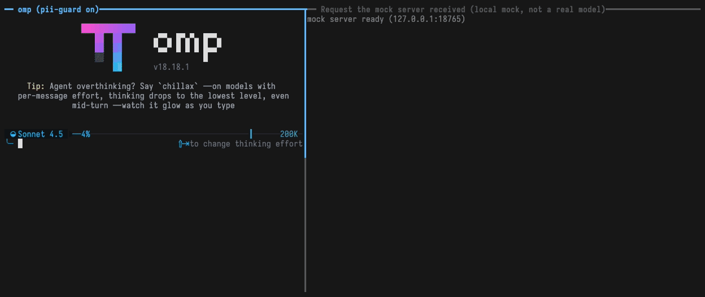
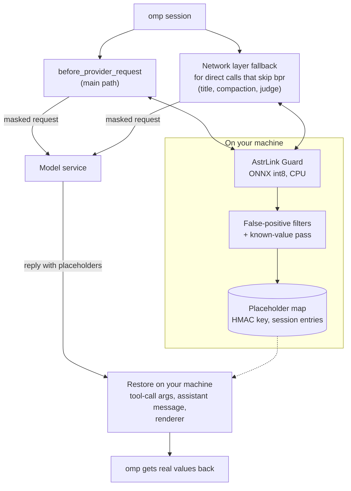

<div align="center">

# omp-pii-guard

### Find and mask names, addresses, phones, emails, accounts and passwords before a prompt leaves your machine.

**An [omp](https://github.com/can1357/oh-my-pi) extension that masks personal data with a local model before a request leaves your machine,<br>
and puts the real values back in the reply.**<br>
A 37 MB int8 model on the CPU, no network call of its own at run time, and a request it fails to process is not sent. Recognition is best effort, not a guarantee: see [what fail-closed covers](#fail-closed-and-no-retry-storm) and [How well it finds things](#how-well-it-finds-things).

[](LICENSE)   

**[Quick start](#quick-start)** &nbsp;·&nbsp; **[How it works](#how-it-fits-together)** &nbsp;·&nbsp; **[Performance](#performance)** &nbsp;·&nbsp; **[Configuration](#configuration)** &nbsp;·&nbsp; **[Limitations](#limitations)** &nbsp;·&nbsp; **English** · [简体中文](README.zh-CN.md)

</div>

<br>

<div align="center">

</div>

<sub>Left: a real omp 18.18.1 session with this extension and the real model. Right: what a local mock server (127.0.0.1, not a real model) actually received. All data is made up. The extension's own notices, such as the `/pii` status line, are in Chinese. Re-record it with [`docs/demo/record.sh`](docs/demo/record.sh) (see [Development and tests](#development-and-tests)).</sub>

## Is omp-pii-guard for you?

An agent puts everything it reads into the prompt: a customer's name in a log, an address in a config file, a password in an `.env`. Once the request leaves your machine, the model vendor has it. omp-pii-guard sits between omp and the vendor:

- **Mask six kinds of personal data**: person names, addresses, phone numbers, emails, accounts (bank and card numbers) and passwords. A local model finds them; filters ported from [magpie](https://github.com/yetone/magpie) keep code identifiers, module names and package names from being mistaken for them.
- **Get the real values back**: the model answers with placeholders such as `{{PERSON_k3v9x2mq}}`; tool-call arguments and assistant messages are restored on your machine, so a file the agent writes or a command it runs has the real value.
- **Quiet on the network**: the model runs on the CPU, locally. The extension itself goes online only in `/pii setup`, to download the model files (your prompts still go to your model service, masked).
- **Fail closed on errors**: if the model is missing, recognition errors out, the format is unsupported or the time runs out, the request is not sent, and the message says why and how to turn masking off.

**What that does and doesn't promise.** Fail-closed covers *processing failures*. When recognition succeeds but the model or the filters don't flag a value (on the synthetic corpus below, 94.9% of planted values were fully masked, and bare account numbers in `KEY=value` lines 0 of 40), the missed value goes out as written, with no error. Treat the extension as a strong extra layer, not a guarantee, and check what matters with `PII_GUARD_NO_RESTORE=1` (see [Commands](#commands-and-switches)).

It's for you if you use omp with a hosted model and the text it reads may contain people's data. If you only need API keys and tokens masked, omp's own Hide Secrets does that; the two work side by side (see [Alongside Hide Secrets](#alongside-omp-hide-secrets)).

Verified on omp 18.18.x and macOS arm64. Other environments are untested; the network layer relies on omp internals and warns on other omp versions.

## Quick start

**1 · Install.**

```sh
omp plugin install github:2530442368/omp-pii-guard
```

Restart omp. There is no model yet, so **every request to a model service is blocked** (fail-closed), and the message points at `/pii setup`.

**2 · Get the model.** In omp, run `/pii setup`. It is the only command that goes online; the extension never downloads anything on its own. No restart is needed afterwards.

**3 · (Optional) show real values in streaming replies.**

```sh
omp config set extensionRenderers.assistantText true
```

Then `/pii` shows the status. That's it.

<sub>Needs about 40 MB of disk for the model and about +100 MB of resident memory at run time (measured numbers in [Performance](#performance)). Prefer a clone? See [Install from a clone](#install-from-a-clone). `/pii setup` order: a file already in the target directory that passes verification is skipped → a verified copy in a local magpie cache is copied → otherwise the three files (about 37 MB) are downloaded from a pinned Hugging Face revision. Each file is written to a temporary file in the same directory and replaced atomically only after its size and sha256 check out; a failed check, HTTP error, timeout or a redirect downgrading to http leaves no target file, never replaces a good existing file, and gives the reason.</sub>

## How it fits together



Both layers share one request-body walker. It rewrites only the strings of user and assistant text, tool-result text, tool-call arguments and system/instructions. It does not touch thinking/signature blocks, `encrypted_content`, compaction blocks, tool definitions, images, `id`/`name`/`model`, or protected placeholders; BigInt and Uint8Array values are preserved.

## What it does

### Finding personal data

| | |
| :-- | :-- |
| **Model first** | AstrLink Guard inference over 510-token windows with 128 overlap, then thresholding (default 0.8) |
| **Then filters** | Filters ported from [magpie](https://github.com/yetone/magpie) (`src/filters.ts` and friends): a snake_case word in code, an imported module name or a package name is not a person or a secret; file names and `@2x.png` are not emails |
| **Known values, everywhere** | A value masked once is masked wherever it shows up later in the same request |
| **Short Chinese names** | A person value of 2–4 Han characters that passed the threshold (张伟) joins the known-value pass and is exempt from the 8-byte minimum length (unlike magpie; privacy first), so it is masked even when the model gives it only a low score elsewhere. A two-character name that looks like an ordinary word (方圆, 江山) is not re-masked without a role word or title around it; 3–4 character names stay as in magpie |
| **No key regexes** | Key and token regexes are omp's Hide Secrets' job. The two stack independently |

The cost: the model sees `{{PERSON_…}}`, not the name, so a task about the value itself (why is this account number refused?) can't be done on it. A filter can be wrong now and then; put a false positive in `allow` ([Configuration](#configuration)). Not masked: URLs, IPs and dates. Not handled: images and PDFs, and magpie's custom masking words.

### Placeholders and restoring

| | |
| :-- | :-- |
| **Stable placeholders** | `{{KIND_xxxxxxxx}}` = the first 8 base32 characters of HMAC-SHA256(key, kind ‖ 0 ‖ value). The same value always gets the same placeholder, so the prompt cache stays valid |
| **A key that never leaves** | 32 random bytes in `~/.omp/agent/pii-guard/key` (mode 0600, generated on first run, never part of any request). A key file found with another mode is set back to 0600 |
| **Tool calls restored** | `tool_call` arguments are restored deeply (a written file or a run command gets the real value) |
| **Assistant text restored** | Text blocks are written back to history/persistence with the real values (`omp -p` output, `/copy` and what subagents return are real values; the next request masks them again at egress) |
| **Renderer** | Streaming display swaps real values in and hides an unclosed `{{…` at the end of a line. Needs `omp config set extensionRenderers.assistantText true` |
| **What isn't restored** | Thinking blocks and session titles (the interface doesn't allow it); the response is not restored at the network layer; a placeholder the model rewrote (case, truncation) can't be restored |

**Tools whose arguments are not restored by default**, because the arguments go to an outside service: `web_search`, `generate_image`, any tool whose name starts with `web_`, `fetch` or `browser`, and all `mcp__*` tools. When the call target (`path`/`file_path`/`uri`/`url`) is `xd://<tool>`, the same policy applies to that tool (`write xd://mcp__…` is an MCP call). When it uses an external scheme such as `ssh://`, `http(s)://`, `mcp://`, `pr://` or `issue://`, the whole call is not restored. `local://`, `agent://`, `out://`, `artifact://` (and `file`, `skill`, `history`, `proc`, `omp`) and plain local paths are restored as usual. Other URL-shaped leaves of `read` are not restored either. To let a local MCP (dbhub, git…) restore, list it in `restoreTools` (for example `["mcp__dbhub*"]`); `noRestoreTools` adds more tools to the not-restored list and wins over `restoreTools`.

**Mapping persistence.** Placeholders that appear in a request (with their recognition scores) are written to the current session through `pi.appendEntry("pii-guard.map", …)`. The session file already holds the original text, so this adds no exposure. The map is rebuilt from the branch on `session_start`, `switch`, `branch` and `tree`. Requests masked at the network layer (local/remote compaction and so on) don't go through bpr, so on `session_compact` the compaction result and the known placeholders found in the branch are written to the session the event belongs to; after `--resume`, the placeholders in the summary still restore. There is no global plaintext map file. Subagents share the process with the main session, so the model, caches, placeholder table and wrappers are `globalThis` singletons installed once.

**Scores and `threshold`.** A masked value remembers the model score (stored with the map, appended when the score goes up, highest wins when rebuilt). After you raise `threshold`, an older value whose score is too low is no longer masked again, but its placeholder stays in the map and restores as before.

### Two layers of masking

| | |
| :-- | :-- |
| **`before_provider_request` (main path)** | Picks the format from `ctx.model.api`: `anthropic-messages`, `openai-responses`, `openai-codex-responses` or `openai-completions`. Any other api (including `devin-agent`) fails. It has an internal 25 s deadline (omp sends the original text after a handler's 30 s timeout). On timeout, if the network layer is in place and the request is recognisable, the request is handed to it (no 30 s limit there, capped at 180 s); otherwise the handler returns `{}` and the request is not sent |
| **Network layer fallback** | Covers direct calls that skip bpr (title generation, local/remote compaction, judge…). Wraps `globalThis.fetch`, `globalThis.WebSocket` (queued per connection to keep order) and `http.ClientRequest.prototype.write/end` |
| **Cache across layers** | Recognition results are cached by text sha256 (LRU; the key includes the args context and a config fingerprint), so one text is inferred once. A masked output that changed is cached under the same key, so the second layer doesn't infer again; a different context doesn't hit |
| **Background prescan** | Uses `ctx.setTimeout`: `session_start` scans the whole branch, and `input` / `tool_result` / `assistant_message` / `tool_call` scan new content on arrival, so most egress hits the cache |

**What the network layer touches.** Only requests to an LLM inference endpoint: the path (without the query string) ends in `/messages`, `/messages/count_tokens`, `/responses`, `/responses/compact`, `/chat/completions` or `/completions` (including codex's ws `…/responses`), **and** the origin is a known LLM service or the body is LLM-shaped. A known LLM service is decided by **origin** (scheme + host + effective port; `ws`/`wss` count as `http`/`https`; default ports 80/443). Sources: built-in `https://api.anthropic.com`, `https://api.openai.com`, `https://chatgpt.com`; the `baseUrl` of each provider in omp's model registry (`ctx.models.list()`, authenticated models); the `ctx.model.baseUrl` seen in bpr; and provider base-URL overrides in the environment (`*_BASE_URL`, such as `ANTHROPIC_BASE_URL`: omp sends requests there and `ctx.model.baseUrl` doesn't reflect it). Another port or scheme on the same host is another origin (a local gateway on 3425 is covered, an MCP service on 3000 is not).

- **Inference endpoints of known services**: the body must be maskable. `Blob`, `ReadableStream` and `URLSearchParams` bodies are read in full and then processed; WebSocket binary frames are decoded as UTF-8 first. A body that can't be decoded, can't be parsed or isn't a recognised format is not sent. For WebSocket JSON frames, `type: "response.create"` goes through masking; any other frame must have a string `type`, and every string value must sit under `type`, `id`, `event_id`, `response_id`, `item_id` or `previous_response_id` to pass; otherwise it is not sent (this includes the bare `{}` omp sends after bpr fails).
- **Inference paths on unknown origins**: a body that can't be recognised, can't be parsed or uses an unsupported encoding passes through untouched (plain JSON such as MCP SSE `/messages` on an unknown origin or a chat app's `/channels/1/messages` is not affected); an LLM-shaped body is masked as usual, and a masking failure still blocks it.
- **Everything else** (oauth and models-list requests on the same host, JSON on a non-matching path) is byte-for-byte unchanged. `fetch` first builds the `Request` that actually takes effect (`new Request(input, init)` semantics), then reads headers, decodes and rewrites. `content-encoding` identity/gzip/deflate/br is supported; the rewrite is recompressed and `Content-Length` updated. An unsupported encoding such as zstd on a known service → not sent.

### Fail closed, and no retry storm

| | |
| :-- | :-- |
| **Failure means not sent** | Model unavailable, recognition error, unsupported format or timeout → the request is not sent, with the reason and how to turn masking off. This is about *processing failures*: a value that recognition simply doesn't flag (see [How well it finds things](#how-well-it-finds-things)) is sent as written |
| **Why no rejection** | omp 18.18.1 treats connection-type errors (a rejected fetch wrapped by the SDK as `Connection error.`, a closed WebSocket) as retryable and retries about 10 times; `-p` doesn't exit for 150 s or more |
| **fetch** | Doesn't reject. Returns a synthetic **HTTP 422** (header `x-should-retry: false`, JSON error body `code: pii_guard_blocked`). 422 is outside the omp/SDK retry set and doesn't trigger the `~/.omp/logs/http-400-requests/` request dump that 400/413 do |
| **WebSocket** | First delivers a server `error` event on the connection (`code: pii_guard_blocked`, which the codex provider turns into a non-retryable error), then closes with 1000 (normal closure) |
| **ClientRequest** | Isn't `destroy`ed into a connection error either (the Anthropic SDK would wrap it as a connection error and retry). It yields a synthetic 422 `IncomingMessage` to the caller (a `'response'` event; header `x-should-retry: false`, the same JSON error body as fetch; the request is destroyed once the response is read, and dropped if nobody listens for `response`). The original request is never sent. omp 18.18.1's direct Anthropic path was observed taking exactly this route (omp's own log: `cowork transport rejected … status 422 … x-should-retry false`) |
| **What you see** | The error text is a fixed English sentence; the concrete reason (model missing and so on) is in the UI message. `-p` exits non-zero within seconds, and the request is not sent |

If the model files are missing or corrupt, requests are blocked; the message names the missing file, points at `/pii setup` and says how to turn masking off (`OMP_PII_GUARD=off`). One exception remains: see Limitations for bodies of unrecognised format on a self-hosted gateway.

### Alongside omp Hide Secrets

omp's Hide Secrets replaces secrets with `$$…$$` before they leave; omp-pii-guard leaves those alone and the two stack independently. A `$$…$$` that omp just generated is kept as is; one written literally in your local history is recognised as usual.

Protected placeholders are of exactly two kinds: a `{{…}}` that really exists in the map, and a `$$…$$` omp just generated. The latter must satisfy both of these:

1. It matches omp's format strictly: `$$` + optional `[A-Z0-9]{1,32}_` + 12 characters of `[0-9A-Z]` + optional `:` and one capital letter + `$$`.
2. It was **not written locally.** omp stores the original value locally and only obfuscates it on the way to the model, so a strict-format `$$…$$` that appears literally in any entry of the local session branch (a message, tool result, custom message, compaction/branch summary, file mention… any string in them) or in the local system prompt (`ctx.getSystemPrompt()`) was written by you, a tool or a file (possibly a real password) and is recognised as usual. If the recognised span is the whole `$$<value>$$`, the `$$` on both sides is stripped before filtering.

Only placeholders that aren't found locally are protected; they are recorded in an in-process "confirmed" set (capped at 20,000), and the network layer protects only those. When the local session can't be read, none are protected (better over-masked). The local scan must be complete to count: if the walk hits its limit (depth 12, 200,000 nodes), meets content it can't read (`Map`, class instances…), or reading the system prompt fails, then "not seen" doesn't mean "not there locally" — that request confirms nothing new, strict-format `$$…$$` not already in the confirmed set is recognised as usual, and confirmed ones stay protected; an incomplete mark is cached with the entry and never treated as complete. A span the model recognised that intersects a placeholder is trimmed to the part outside the placeholder and the rest is masked; the known-value pass is unaffected by placeholder protection (a known value inside `$$<known value>$$` is still masked).

### Commands and switches

| | |
| :-- | :-- |
| `/pii` | One-line status joined by ` · ` (readable even when the notification bubble drops line breaks): on/off, whether the model is ready, the kinds masked in this session (person, address, phone, email, account, password) with their distinct-value counts (rebuilt from the placeholder map saved in the target session when you switch to or restore a session or branch, so a resumed session shows what it masked before and `/new` resets to zero), and the number of requests checked (egress and network layer aren't double counted). It appends items for failures, an unavailable model, a missing network layer, a non-default threshold/kinds and restore turned off (a ⚠ or a failure makes the notification level warning) |
| `/pii list` / shortcut `ctrl+alt+p` | Show the values masked in this session: opens a read-only list in omp's interactive UI (a local custom view, not one of omp's select/input dialogs, which can be mirrored to collab guests or RPC clients) with "kind · original value · placeholder · detection score" grouped by kind (long values are truncated, select one to see it in full, Esc closes). **This is the only place original values are displayed**: only in the local interactive omp UI (`ctx.mode == "tui"`), never in the conversation, logs, notifications or the state file; opening it adds no write of its own (the session file already stores the placeholder map, original values included, as described under mapping persistence); control, zero-width and bidi-override characters in a value are shown as visible escapes such as `⟨U+202E⟩`, so a value cannot disguise itself on screen; it reads the same session map as the `/pii` counts, so it is empty after `/new` and a resumed session shows what it masked before. Values masked only by the network layer (such as title generation) are neither listed nor counted until compaction saves their placeholders into the session. In RPC, print (`-p`), json or any other non-`tui` mode, and in a collab-mirrored UI, it never displays anything: it only says "/pii list 需要在 omp 交互界面里查看" (a notification when there is a UI, stderr when there is none), with no original value in it; it is not offered inside subagents. If another extension already holds the shortcut, it warns at start-up, records that in `<data directory>/list-key-taken`, and from the next start does not register the shortcut at all (known limit: omp does not allow checking for a conflict before registering, so on the first start where the conflict is found this extension's registration may already have overridden the other binding; from the next start it does not register and the other binding is back. While `list` is false the Tern click sends nothing, so it never triggers the other extension's handler); use `/pii list` then. The marker is removed at the first start after the shortcut becomes free, and the shortcut is back at the start after that |
| `/pii setup` | Prepare the model: skip verified files, then copy from a local cache, otherwise download from the pinned Hugging Face revision and verify (about 37 MB, in the background with a notification when done; running it again while in progress doesn't download concurrently). The only command that goes online |
| `/pii off` / `/pii on` | Turn masking off/on for every session in the process, subagents included. While off, requests go out as written; restoring still works |
| `OMP_PII_GUARD=off` | Global off for no-UI use (`off`, `0`, `false` or `disabled`): no network layer, no hooks, only `/pii` remains |
| `PII_GUARD_NO_RESTORE=1` | **For testing only**: turns every restore off so the model repeats placeholders as is, which shows that the server received placeholders |

Startup self-check: `session_start` checks that the network-layer wrappers are still in place; on an omp version other than the verified 18.18.x it warns "network-layer masking not verified on this version" (not blocking); it warms the model in the background and reports a load failure immediately.

### Tern status-line plugin (optional)

When you run omp inside [Tern](https://docs.stencil.so/tern/), a small clickable PII segment can sit in Tern's status line: it shows at a glance whether protection is on and how many distinct values this session has masked, and a click opens the "values masked in this session" list in the omp pane (the same list as `/pii list`). The plugin lives in `tern-plugin/`, is plain Luau, only reads the counts-only state file the extension writes and sends one shortcut to the omp pane, and changes nothing else in Tern.

```sh
tern plugin install <repository directory>/tern-plugin --force   # install (or update)
tern plugin list                                                # should show pii-guard … ready
tern plugin remove pii-guard                                    # uninstall
```

- **The status line is off by default**: turn it on in Tern first — run "Show status line" (action `status_bar`) from the command palette (⌘K). With it off you can still run "PII Guard：查看遮挡的值" from the command palette (opens the same list); "PII Guard：显示遮挡情况" only pops up the same counts notice as `/pii`.
- **What it shows**: only while the focused pane runs an omp that has this extension (other panes show nothing; it disappears when omp exits). `PII 4` = 4 distinct values masked in this session (the sum over kinds, same count as `/pii`; `PII 0` before anything is masked); `PII 关` ("off") = protection is off (`/pii off` or `OMP_PII_GUARD=off`), gray; it turns red with an alert-shield icon when the model is unavailable, a request failed (was blocked) or the network layer is missing; otherwise a shield icon, in the accent colour once something has been masked. Clicking opens the original-value list (next item); the counts notice (on/off and model state first, then the per-kind counts and the number of requests checked, word for word the `/pii` summary; it wraps in a narrow window) is under "PII Guard：显示遮挡情况" in the command palette.
- **What a click does**: the plugin re-checks live (nothing cached) that the state file is valid and says `list` is `true`, that its pid is alive, that `ps` reports the pid in the foreground of its terminal and not suspended (`stat` contains `+`, no `T`/`Z`) with an executable named `omp`, that the `TERN_PANE` value in that process's environment equals the target pane (Tern's plugin API gives a pane no process id or tty, so the environment Tern set for the pane's processes is the only link; the plugin reads it through a shell pipeline that keeps just that one token, nothing else of the environment reaches the plugin, and an unreadable environment counts as not matching), that Tern reports the pane as omp (`kind` is `agent`, or the program is `omp`), and that it is the focused pane; only then it sends the shortcut `ctrl+alt+p` (kitty keyboard protocol sequence `ESC[112;7u`) to that pane, and the omp extension opens the list in omp's own UI. The plugin never reads, writes or handles any original value; a pane without such an omp (a plain shell, say) only gets a notice and no key is sent. If omp was suspended with Ctrl+Z (the pid stays alive but the key would land in the shell) or has exited, the click only shows "omp 现在不在这个窗格的前台"; if `list` is `false` (shortcut held by another binding, or omp too old to tell) it only shows "在 omp 里输入 /pii list 查看"; in both cases nothing is sent; if the pid does not belong to the pane (a state file that points at another pane's omp, or a recycled pid), the click says it cannot confirm that and sends nothing. After `fg` the click works again. A draft left unsent in the input box stays as it was.
- **How it works**: when the omp extension runs inside Tern (`TERN_PANE` is set) it writes the state of the current **interactive** session (the main session with a UI; subagents and no-UI modes don't write) to `<data directory>/tern/<TERN_PANE>.json` (default `~/.omp/agent/pii-guard/tern/`): it first checks the state directory (a real directory owned by the current user, not a symlink, tightened to 0700, otherwise the write is skipped) and then writes atomically via a randomly named exclusive-create (`wx`) temp file and rename, mode 0600, one coalesced write within about 0.5 s of a change; it is deleted when the session closes or omp exits — only a file this process wrote and whose pid is its own (a process in the same pane that never wrote, such as `omp -p`, doesn't delete the interactive omp's file); a file left behind by a killed omp is ignored by the plugin via its pid, and the next omp that writes sweeps leftovers whose pid no longer exists). Outside Tern (no `TERN_PANE`) the extension writes nothing. Every 2 s the plugin looks at the file for the focused pane, parses it only if it exists, and runs `kill -0` about every 6 s to confirm the omp process is alive; with no file it does just one `fs.exists` per 2 s and starts no process. The plugin treats the state file as untrusted input and validates it field by field (version, pid/pane as bounded positive integers, boolean and enum types, every count a finite non-negative integer, `summary` a string of at most 500 characters) before showing anything; any mismatch counts as no state, and `kill -0` runs only on a validated pid. The status formatter only reads a cache and does no I/O.
- **The state file holds only counts and status — no original value, placeholder or session content**: `v` (format version, currently 1), `pid`, `pane`, `on`/`off` (the switch and why it's off, `env`/`user`), `model` (`state`: `ready`/`loading`/`setup`/`unavailable`/`idle`; `reason` when unavailable: `files`/`other`), `kinds` (distinct values masked this session for each of the six kinds), `requests`, `failed`, `level` (`info`/`warning`), `summary` (the same one-line summary as `/pii`; when the model failed to load it contains the local model path and the error reason, as `/pii` does), `list` (boolean: this extension's list shortcut is registered and no other binding holds it; the plugin sends the key only when it is `true`; optional for the plugin, absent counts as `false`), `updatedAt`.
- **A non-default data directory**: if you changed the extension's data directory with `PII_GUARD_DIR`, the plugin must read the same one: put `{"state_dir": "<the same directory as PII_GUARD_DIR>"}` in `<Tern config directory>/plugin-data/pii-guard/kv.json` (macOS: `~/Library/Application Support/Tern/plugin-data/pii-guard/kv.json`; the plugin appends `/tern`), or give the Tern process a `PII_GUARD_DIR` of its own; with neither it uses `~/.omp/agent/pii-guard`.
- **Limits**: Tern only; only the focused pane is shown; an omp run inside `ssh`/`tmux` within a pane is unverified; verified on Tern 0.9.16, and a Tern plugin API change may need a matching update; the plugin has no control to switch PII protection from Tern (use `/pii on|off` in omp); opening the list by click needs the shortcut `ctrl+alt+p` to be registered by this extension and not held by another binding (otherwise the click only points you to `/pii list`), and omp to run in Tern's native view or a terminal that parses kitty keyboard sequences (the plain terminal view is unverified; there Tern may report the foreground program differently, e.g. `fg` after a suspend, which is why a pane whose kind is `agent` is accepted too). The pane check guards against stale or mismatched state files, not against a hostile process of the same user: such a process could set `TERN_PANE` itself, and it could type into the pane anyway.

## Performance

Numbers below come from `bun run bench`, one run on a real machine, not estimates. Reproduce them with the commands at the end of this section; numbers on your hardware will differ.

Measured on an Apple M3 Max (14 cores, 36 GB), macOS 26.3.1 (darwin 25.3.0), omp 18.18.1 (Bun 1.4.4), onnxruntime-node 1.31.1, the pinned int8 model, **4 threads** (3 windows in flight), on 2026-11-09. The machine was not idle: other processes were running (1-minute load average between 4 and 11 during the runs), so treat small differences with care. Each timing is the median of 3 runs unless noted.

### What it costs

| | |
| :-- | :-- |
| **Model load** | 96 / 92 / 92 / 93 ms at 1 / 2 / 4 / 8 threads, each in a fresh process (91 ms in the full 4-thread run). Includes importing onnxruntime and the tokenizer; the model files were in the OS page cache |
| **Memory** | RSS 11 MB before load → 94 MB after load (+83 MB) → 119 MB after three warm-up inferences (+108 MB) |
| **One 510-token window** | 46.8 ms for English prose, 46.3 ms for Chinese prose (median of 30; p95 47.1 / 46.7 ms) |
| **Throughput, inference** | Chinese prose 30.4, English prose 26.9, code 36.3, JSON tool output 49.9 ms per KB, one document at a time |
| **Everything after inference** | Thresholding, filters, replacement: 0.003–0.035 ms per KB, negligible next to inference |
| **Open an old session** | Prescan of a 504 KB / 118-leaf mixed history with nothing cached: 17.7 s (17.7 / 17.7 / 17.7 s), about 35 ms per KB, in the background |
| **Egress after prescan** | The same history, first request: 7.6 ms (spans filtered and replaced); repeated requests: 0.37 ms (median of 5), all cache hits |
| **A new tool output** | 20.2 KB of fresh JSON tool output on top of the cached history: 1047 ms (1044 / 1048 / 1047 ms), mostly inference |
| **Known-value pass** | 1 Mi characters × 1000 known values, 4187 hits: 25.9 ms with a fresh index (31.1 / 24.6 / 25.9 ms), 24.5 ms with the index cached |

In short: most of the time is the model, roughly 25–50 ms per KB of new text at 4 threads, so a 20 KB tool result adds about a second to its first request, and anything already seen is free.

The history for the prescan and egress rows is built from four content types in turn: Chinese prose, English prose, code from the dependency sources, and JSON tool output (synthetic, no personal data). The throughput figures use about 64 KB of each type, cut into documents of about 4 KB (code: whole files under 20 KB).

### Threads

Every row is a fresh process. Concurrent windows = cores / threads, as in the extension. Scaling is close to linear because each window runs on its own threads:

| Threads | Concurrent windows | One window, English | One window, Chinese | Chinese ms/KB | English ms/KB | Code ms/KB | JSON ms/KB | Prescan 504 KB | RSS after warm-up |
| --- | --- | --- | --- | --- | --- | --- | --- | --- | --- |
| 1 | 14 | 174.5 ms | 174.6 ms | 112.6 | 99.3 | 135.4 | 186.0 | 66.2 s | 121 MB |
| 2 | 7 | 90.8 ms | 90.5 ms | 58.8 | 51.7 | 70.2 | 96.7 | 34.4 s | 118 MB |
| **4** | 3 | 46.8 ms | 46.5 ms | 30.4 | 26.9 | 36.2 | 50.0 | 17.7 s | 122 MB |
| 8 | 1 | 25.3 ms | 24.8 ms | 16.4 | 14.5 | 19.9 | 27.6 | 9.9 s | 121 MB |

The default is `min(4, cores/2)`; raise `threads` in [Configuration](#configuration) if you want faster scans and have the cores. (The 4-thread row comes from a separate process from the table above, hence slightly different numbers.)

### How well it finds things

A synthetic corpus with known answers (seed 20260101): 397 short paragraphs (164 KB), 100 invented values for each of the six kinds in Chinese and in English, 1200 in total. Each paragraph is a few background sentences around 2–4 lines that carry a value (a sentence, a `Key: value` line, a JSON fragment or a `KEY=value` line); the background sentences include things that look like code (snake_case names, version numbers, paths, package imports, URLs). "Fully masked" means a span of the right kind covers the whole value after the threshold (0.8) and the false-positive filters. The corpus is template-based, so read the numbers as a regression check of this pipeline, not as a promise about your data.

| Kind | Planted | Fully masked | Touched | Chinese | English |
| --- | --- | --- | --- | --- | --- |
| PERSON | 200 | 99.0% | 99.0% | 99.0% (99/100) | 99.0% (99/100) |
| ADDRESS | 200 | 100.0% | 100.0% | 100.0% (100/100) | 100.0% (100/100) |
| PHONE | 200 | 93.0% | 93.0% | 86.0% (86/100) | 100.0% (100/100) |
| EMAIL | 200 | 100.0% | 100.0% | 100.0% (100/100) | 100.0% (100/100) |
| ACCOUNT | 200 | 78.0% | 78.0% | 79.0% (79/100) | 77.0% (77/100) |
| SECRET | 200 | 99.5% | 100.0% | 100.0% (100/100) | 99.0% (99/100) |
| **All** | 1200 | 94.9% | 95.0% | 94.0% (564/600) | 95.8% (575/600) |

"Touched" = any span overlaps the value (a value masked in part leaves its tail in the prompt; for the one SECRET, the trailing `?` of a password stayed outside the span). No value was masked with the wrong kind.

Where the misses are:

| Kind | sentence | field | json | env |
| --- | --- | --- | --- | --- |
| PERSON | 99.2% (119/120) | 100.0% (50/50) | 96.7% (29/30) | — |
| ADDRESS | 100.0% (66/66) | 100.0% (103/103) | 100.0% (31/31) | — |
| PHONE | 82.9% (68/82) | 100.0% (81/81) | 100.0% (37/37) | — |
| EMAIL | 100.0% (85/85) | 100.0% (72/72) | 100.0% (43/43) | — |
| ACCOUNT | 100.0% (82/82) | 94.9% (74/78) | — | 0.0% (0/40) |
| SECRET | 100.0% (38/38) | 100.0% (87/87) | 97.0% (32/33) | 100.0% (42/42) |

- **Bare account numbers in `ACCOUNT_NO=…` lines**: the model returned no span for any of the 40 (score ≥ 0.5). Account numbers in sentences and `Key: value` lines (`Bank account number:`, `银行卡号：`) are found, except 4 of 78 `Key: value` lines.
- **Chinese phone numbers in "请拨打…联系我。"**: the model found all 14 with a score of 0.99+, but the ported filter drops a bare all-digit number unless a cue word (电话, 手机, phone…) is nearby, and 请拨打 isn't one. The other 86 Chinese phone numbers, each after a cue (`联系电话：`, `手机号 …`, `手机:`), were all masked. Of the 1200 values, 61 were not fully masked: 40 had no model span at all, 4 only spans below the threshold, 17 had a span the filters dropped or trimmed.
- **False positives on the synthetic text**: none. 0 spans were masked outside the planted values in the annotated paragraphs, and 0 in 200 entity-free control paragraphs (204 KB, same background sentences).
- The whole pipeline (including the known-value pass) replaced 1140 spans in the annotated paragraphs: PERSON 198, ACCOUNT 156, EMAIL 200, ADDRESS 200, PHONE 186, SECRET 200.

**Public code.** The same pipeline on two public corpora: the dependency sources a fresh `npm ci` puts in `node_modules` (151 `.js`/`.mjs`/`.cjs`/`.ts`/`.md` files, 659 KB, 19 packages) and this repository's `src/` (20 files, 247 KB, Chinese-commented TypeScript).

| Corpus | Model spans after filters | Whole pipeline replaced (incl. known-value pass) | Pipeline, by kind | snake_case values replaced | import/package names replaced | Identifier-shaped values replaced |
| --- | --- | --- | --- | --- | --- | --- |
| `node_modules` | 6 | 6 | SECRET 1, EMAIL 2, PERSON 3 | 0 | 0 (241 names collected) | 1 |
| `src/` | 24 | 39 | EMAIL 3, SECRET 3, ADDRESS 1, PHONE 4, ACCOUNT 1, PERSON 27 | 0 | 0 (32 names collected) | 4 |

Two ways of counting: "model spans" are what the model found after the threshold and the false-positive filters; "whole pipeline" is what is actually replaced, which adds the known-value pass (a value masked once is masked wherever it appears again, which is why `src/` goes from 24 to 39: the same sample names and phones recur in its comments). The conclusions below use the whole-pipeline count, 45 replaced spans in total.

Every one of the 45 is example data written into documentation or comments: a sample `var password = "1234567890";` in adm-zip's README, `ex@mple.com` and the names `John`, `Tiny Andrew`, `Carla Smith` in type-fest's examples, and in `src/` the sample phones, emails, names, passwords and addresses that the filter comments use (`13800138000`, `a.b@c.com`, `张伟`, `李娜`, `letmeinplease`, `42 Wallaby Way`…). The 5 identifier-shaped ones are sample values too: `John`, `k3Xq9vB2mZ`, `letmeinplease`, `purplemonkey` and `DE89370400`. None is a snake_case word, module name or package name, so nothing in this sample was a false positive on code. The full list with file and line is in the benchmark output. The dependency corpus is small and mostly code with little prose, so "0 snake_case or module names replaced" says the filters hold on this sample, not on every codebase.

### Reproduce

```sh
npm ci --ignore-scripts      # or the extension's own install; the dependency corpus is node_modules
bun run bench                # everything, 4 threads (about 2 minutes)
bun run bench sweep          # thread sweep: 1, 2, 4, 8 threads, a fresh process each (about 10 minutes)
bun run bench speed          # or: effect
```

The model directory is taken from `PII_GUARD_MODEL_DIR`, else `<data dir>/model`, else the magpie cache; run `/pii setup` first. Other knobs: `THREADS`, `PII_BENCH_JSON=out.json` (writes the results as JSON), `PII_BENCH_SEED`, `PII_BENCH_PER_KIND`, `PII_BENCH_REPS`. The default run reads only the synthetic generator (`scripts/bench-corpus.ts`), `node_modules` and `src/`. To add your own code or omp sessions, set `PII_BENCH_DIRS` / `PII_BENCH_SESSIONS`; those are reported as counts and shapes only, never as values.

**About the synthetic values.** Everything is invented and random: names are random combinations, phone numbers are random mainland-China mobile numbers or North-American `555-01xx` numbers, account numbers start with 9, card numbers are randomly generated 16-digit numbers with the prefix 4000 00 and a valid Luhn checksum, not taken from any real card data (they can still coincide with a real number by chance), passwords are random 12–18 character strings of mixed case, digits and symbols and don't resemble any real key format, and email domains are made-up words under real TLDs. Domains are deliberately not `example.com/.org/.net`, `.test`, `.invalid`, `.example` or `localhost`, because the email filter lets those through as fake addresses and the recall would no longer measure real-looking emails. Random values can coincide with real ones by chance; nothing was ever called, paid to, mailed or visited.

## Configuration

Optional file `~/.omp/agent/pii-guard/config.json`, read at `session_start`; an invalid field falls back to its default with a notice:

```json
{
  "threshold": 0.8,
  "threads": 4,
  "kinds": ["PERSON", "ADDRESS", "PHONE", "EMAIL", "ACCOUNT", "SECRET"],
  "allow": ["some false-positive word"],
  "noRestoreTools": ["my_http_tool", "mcp_search*"],
  "restoreTools": ["mcp__dbhub*"]
}
```

| | |
| :-- | :-- |
| **`threshold`** | Model score threshold, 0.5–1, default 0.8 |
| **`threads`** | ONNX Runtime threads, default `min(4, cores/2)`. Concurrent windows globally = `cores / threads`. Restart omp to change it |
| **`kinds`** | Enabled kinds, default all |
| **`allow`** | Whole values never masked (case-insensitive); use it to fix false positives |
| **`noRestoreTools`** | Extra tool names whose arguments are not restored (wildcard, `*` matches any string; case-insensitive) |
| **`restoreTools`** | Tool names allowed to restore (wildcard). `mcp__*` tools are not restored by default; local MCP goes here |

Environment variables: `PII_GUARD_DIR` (data directory, default `~/.omp/agent/pii-guard`), `PII_GUARD_MODEL_DIR` (model directory, default `<data directory>/model`), `PII_GUARD_MODEL_SRC` (local cache to copy the model from, default `~/.cache/magpie/astrlink-guard/7216b6a3b897`; the `int8/` directory under it is also accepted), `OMP_PII_GUARD`, `PII_GUARD_NO_RESTORE` (above).

## Install from a clone

```sh
git clone https://github.com/2530442368/omp-pii-guard && cd omp-pii-guard
scripts/install.sh
```

- **Model**: first tries to copy from the magpie cache into `~/.omp/agent/pii-guard/model/` and verify sha256 (result files are mode 0644). A file missing from the cache is **not an error**: the script still installs the extension (exit code 0), prints the pinned download URLs and tells you to run `/pii setup` after restarting omp (the script itself never goes online, and until the model is ready every request is blocked). Only a cached file whose size or sha256 doesn't match is an error, with a non-zero exit (the extension is not installed).
- **Extension**: copies `src/`, `package.json` and the lock file to `~/.omp/agent/extensions/pii-guard/` and runs `npm ci --ignore-scripts` (dependencies pinned to `onnxruntime-node@1.31.1` and `@anush008/tokenizers@0.6.0`).
- It generates no key and changes no omp configuration. Restart your omp sessions afterwards.

Don't put code under `~/.omp/agent/extensions` while developing (every new session would load it); load the repository explicitly with `omp -e <repository directory>`.

**Model source.** [QuantumNous/astrlink-guard](https://huggingface.co/QuantumNous/astrlink-guard) revision `7216b6a3b897ef903d4b1ba367ae6fb95b0fa5e4`, the `int8/` directory:
`https://huggingface.co/QuantumNous/astrlink-guard/resolve/7216b6a3b897ef903d4b1ba367ae6fb95b0fa5e4/int8/{model_int8.onnx,model_int8.onnx_data,tokenizer.json}` (Hugging Face redirects to a CDN). The expected sizes and sha256 are pinned in `MODEL_FILES` in `src/guard.ts` (`scripts/install.sh` keeps the same values; a test asserts they match). The model is Apache-2.0 and is not part of this repository. By default it is stored in `~/.omp/agent/pii-guard/model/` (`PII_GUARD_DIR` / `PII_GUARD_MODEL_DIR` change that).

## Limitations

- The network layer relies on omp internals (how fetch, WebSocket and `https.request` are used). If an omp upgrade changes how requests are sent, direct paths can quietly leak (the bpr path still masks); hence the version notice.
- Unsupported request formats (`devin-agent`, Google, Bedrock…): the bpr layer fails (the request is blocked); the network layer likewise doesn't send an unrecognised body on a matching inference path of a known host, and lets non-matching paths through unchanged. The SDK request paths of the four supported formats always end in `/messages`, `/responses` or `/chat/completions` (a gateway prefix doesn't matter); handing bpr timeouts to the network layer depends on this.
- On a self-hosted gateway that isn't a known origin (not in the model registry, no `*_BASE_URL`, never seen in bpr), a body of unrecognised format on an inference path (a zstd-compressed one, say) passes through unchanged; LLM-shaped JSON is still masked.
- Remaining edge of the `$$…$$` origin check: a strict-format `$$…$$` written literally in request content that is neither in the session branch nor in the system prompt (text of `/btw` that isn't persisted, reminders or file content spliced in at request time) is treated as an omp placeholder and kept (not masked).
- The network layer doesn't read `FormData` / stream bodies of non-inference endpoints (they pass through unchanged).
- A key file found with permissions other than 0600 is always set back to 0600.
- Original text carried in thinking blocks can't be changed; the session title is generated by the model from the already-masked first message and may contain placeholders; both show placeholders.
- The network layer doesn't restore responses; a placeholder the model rewrites (case, truncation) can't be restored.
- Later codex turns send only the increment in `input` (the history lives on the server); back-filled masking affects only later requests.
- The first time you open a very long old session, wait for the background prescan (measured: 17.7 s for a 504 KB mixed history, about 35 ms per KB, 4 threads, see [Performance](#performance)); when a scan goes over budget it is handled fail-closed instead of sending the original.
- Resident memory is about +100 MB under Bun (model included; measured +108 MB after warm-up, see [Performance](#performance)).
- CLI subcommands that don't load extensions, such as `omp commit`, are not covered.
- URLs, IPs and dates are not masked; images and PDFs are not handled; magpie's custom masking words are not supported.
- A long whitespace-free base64/hash-like string (≥1 KB, only `A-Za-z0-9+/_=-`) is treated as a binary payload and not sent to the model (the known-value pass still runs on it).

## Development and tests

```sh
bun test                # with Bun
BUN_BE_BUN=1 omp test   # without Bun: the omp binary ships Bun (use your install path, e.g. Tern's omp/versions/18.18.1)
bun run bench           # the benchmark behind the Performance section
```

Re-record the demo GIFs in `docs/demo/` (needs [vhs](https://github.com/charmbracelet/vhs), tmux, gifsicle, an omp 18.18.x binary, and the model on disk; macOS: `brew install vhs tmux gifsicle`; the recordings use the Sarasa Mono SC font, `brew install --cask font-sarasa-gothic`):

```sh
npm ci --ignore-scripts
OMP_BIN=/path/to/omp PII_GUARD_MODEL_DIR=~/.cache/magpie/astrlink-guard/7216b6a3b897 docs/demo/record.sh   # zh|en|all, default all
```

It runs a real omp (this extension, a temporary HOME and data directory, a fake API key; `~/.omp` is not touched) against `docs/demo/mock-server.ts`, a local mock of the Anthropic Messages API on 127.0.0.1 that prints the last user message it receives and replies from a fixed template quoting the placeholders. `demo.zh-CN.tape` and `demo.en.tape` hold the typing script.

The tests include the magpie cases ported in T2, pipeline / entry / network-layer tests driven by a fake recognizer (a local http and WebSocket server checks the real bytes), and real-model tests (the model directory defaults to the magpie cache; they are skipped if it doesn't exist). The timing numbers are not asserted in tests, because timings are flaky.

`tern-plugin/` (Luau, runs inside a Tern window) has no automated tests; the writer of the state file (`src/tern.ts`) is covered by `test/tern.test.ts`. After changing the plugin, check it in Tern: `tern plugin install tern-plugin --force`, run an omp with this extension in a Tern pane (it can talk to a local mock server), and confirm the status-line segment, the click details, and that it disappears when omp exits.

## Acknowledgements

- The false-positive filters are ported or derived from [magpie](https://github.com/yetone/magpie) (MIT); see `NOTICE`. The shape of this README follows magpie's.
- Model: [QuantumNous/astrlink-guard](https://huggingface.co/QuantumNous/astrlink-guard) v0.1.3 (Apache-2.0). This repository doesn't distribute the model files.

## License

MIT, see [LICENSE](LICENSE) and [NOTICE](NOTICE). Not affiliated with or endorsed by magpie, omp, QuantumNous or any model vendor.
