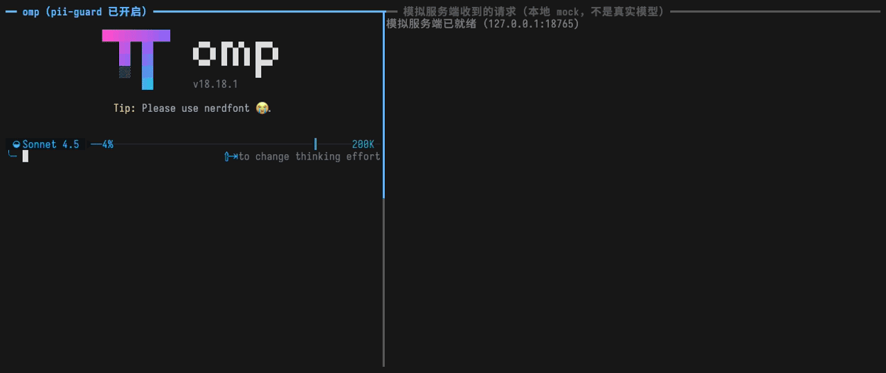
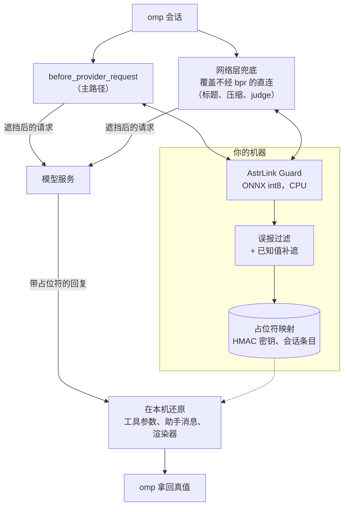

<div align="center">

# omp-pii-guard

### 提示词离开你的机器之前，识别并遮住人名、地址、手机、邮箱、账号、密码。

**一个 [omp](https://github.com/can1357/oh-my-pi) 扩展：请求发出前，用本地模型把个人信息换成占位符，<br>
模型回复里的占位符在本机换回原值。**<br>
37 MB 的 int8 模型跑在 CPU 上，扩展自身运行时不联网；处理失败的请求不会发出。识别是尽力而为，不是保证：见[失败即不发管什么](#失败即不发也不引发重试风暴)与[找得准不准](#找得准不准)。

[](LICENSE)   

**[快速开始](#快速开始)** &nbsp;·&nbsp; **[工作方式](#工作方式)** &nbsp;·&nbsp; **[性能](#性能)** &nbsp;·&nbsp; **[配置](#配置)** &nbsp;·&nbsp; **[局限](#局限)** &nbsp;·&nbsp; [English](README.md) · **简体中文**

</div>

<br>

<div align="center">

</div>

<sub>左栏：真实的 omp 18.18.1 会话 + 本扩展 + 真实模型。右栏：本地模拟服务端（127.0.0.1，不是真实模型）实际收到的内容。演示数据全部虚构。用 [`docs/demo/record.sh`](docs/demo/record.sh) 重录（见[开发与测试](#开发与测试)）。</sub>

## 适合你吗？

智能体读到什么就把什么放进提示词：日志里客户的名字、配置文件里的地址、`.env` 里的密码。请求一旦离开本机，模型服务商就拿到了。omp-pii-guard 站在 omp 与服务商之间：

- **遮六类个人信息**：人名、地址、手机、邮箱、账号（银行卡号等）、密码。本地模型负责找；移植自 [magpie](https://github.com/yetone/magpie) 的过滤规则负责不把代码里的标识符、模块名、包名当成它们。
- **回复里换回原值**：模型用 `{{PERSON_k3v9x2mq}}` 这样的占位符回答；工具调用参数和助手消息在你的机器上还原，所以智能体写出的文件、执行的命令拿到的是真值。
- **网络上保持安静**：模型在本机 CPU 上跑；扩展自身只在 `/pii setup` 里联网，下载模型文件（你的提示词照常发往你的模型服务，只是已遮挡）。
- **出错即不发**：模型不可用、识别出错、格式不支持、超时，请求都不会发出，并给出原因与关闭方法。

**这句话管什么、不管什么。** fail-closed 管的是*处理失败*。识别成功但模型或过滤规则没把某个值标出来时（下文合成语料上，种下的值 94.9% 被完整遮住，`KEY=值` 行里的裸账号 0/40），漏掉的值照常原样发出，也不会报错。把它当作一层很强的额外防护，而不是保证；要紧的内容请用 `PII_GUARD_NO_RESTORE=1` 自己核对（见[命令与开关](#命令与开关)）。

如果你用 omp 连接托管模型，而它读到的文本里可能有人的数据，它就适合你。只想遮 API 密钥和令牌，omp 自带的 Hide Secrets 就够了；两者可以叠加（见[与 omp Hide Secrets 共存](#与-omp-hide-secrets-共存)）。

已验证环境：omp 18.18.x、macOS arm64。其他环境未验证；网络层依赖 omp 内部实现，版本不是 18.18.x 时会提示。

## 快速开始

**1 · 安装。**

```sh
omp plugin install github:2530442368/omp-pii-guard
```

重启 omp。此时还没有模型，**所有发往模型服务的请求都会被阻止**（fail-closed），提示里会指向 `/pii setup`。

**2 · 准备模型。** 在 omp 里运行 `/pii setup`。只有这个命令会联网，扩展从不自动下载。完成后无需重启即可遮挡。

**3 ·（可选）流式回复里显示原值。**

```sh
omp config set extensionRenderers.assistantText true
```

然后 `/pii` 查看状态。就这些。

<sub>模型约占 40 MB 磁盘，运行时常驻内存约 +100 MB（实测数字见[性能](#性能)）。想用克隆安装？见[克隆后安装](#克隆后安装)。`/pii setup` 的顺序：目标目录里已有且校验通过的文件跳过 → 本机 magpie 缓存里有且校验通过的复制 → 否则从 Hugging Face 固定修订下载三个文件（约 37 MB）。每个文件先写同目录的临时文件，校验大小与 sha256 通过后才原子替换；校验失败、HTTP 错误、超时、重定向降级到 http 都不留下目标文件、不替换已有的正确文件，并给出原因。</sub>

## 工作方式



两层遮挡共用同一个请求体遍历器：只改用户/助手文本、工具结果文本、工具调用参数、system/instructions 的字符串；不碰 thinking/signature、`encrypted_content`、compaction 块、工具定义、图片、`id`/`name`/`model`、受保护的占位符；保留 BigInt、Uint8Array。

## 它做什么

### 识别个人信息

| | |
| :-- | :-- |
| **模型优先** | AstrLink Guard 推理（510 token 窗口、重叠 128），再按阈值（默认 0.8）筛 |
| **再过滤** | 移植自 [magpie](https://github.com/yetone/magpie) 的误报过滤（`src/filters.ts` 等）：代码里的 snake_case 词、import 的模块名、包名不是人名/密钥；文件名与 `@2x.png` 不是邮箱 |
| **已知值，处处遮** | 同一请求内，已遮的值在别处也遮 |
| **中文短名字** | PERSON 类、由 2–4 个汉字组成且已过阈值的已知值（张伟）参与已知值补遮：不受 8 字节最短长度限制（与 magpie 的差别，隐私优先），模型在别处只给低分时也遮。不足 8 字节（两字）的名字与普通词同形（方圆、江山）时，没有角色词/称谓的语境不补遮；3–4 字名字保持 magpie 原样 |
| **不做密钥正则** | 密钥与令牌的正则是 omp 自带 Hide Secrets 的事；两者独立叠加 |

代价：模型看到的是 `{{PERSON_…}}` 而不是名字，所以围绕值本身的任务（这个账号为什么被拒？）在它身上做不了。过滤规则偶尔会错；把误报放进 `allow`（见[配置](#配置)）。不遮 URL、IP 和日期；不处理图片与 PDF；不支持 magpie 的自定义遮挡词。

### 占位符与还原

| | |
| :-- | :-- |
| **稳定的占位符** | `{{KIND_xxxxxxxx}}` = base32(HMAC-SHA256(key, kind ‖ 0 ‖ value)) 前 8 位。同值同占位符，保证提示缓存稳定 |
| **不出本机的密钥** | `~/.omp/agent/pii-guard/key`（32 字节随机，0600，首次运行时生成，不进任何请求）。读到时权限不是 0600 一律改回 0600 |
| **还原工具调用** | `tool_call`：深度还原参数（写文件、执行命令拿到真值） |
| **还原助手文本** | 文本块换回原值写入历史/持久化（`omp -p` 输出、`/copy`、子代理交回内容为真值；下次请求时在出口重新遮挡） |
| **渲染器** | 流式显示时换回原值，行尾未闭合的 `{{…` 先隐藏。需要 `omp config set extensionRenderers.assistantText true` |
| **不还原的** | 思考块、会话标题（接口不支持）；网络层不还原响应；模型改写占位符（大小写、截断）时无法还原 |

**默认不还原参数的工具**（参数会发往外部服务）：`web_search`、`generate_image`、名称以 `web_`/`fetch`/`browser` 开头的工具、全部 `mcp__*` 工具。调用目标（`path`/`file_path`/`uri`/`url`）是 `xd://<工具>` 时按该工具套用同一策略（`write xd://mcp__…` 就是调用 MCP），是 `ssh://`、`http(s)://`、`mcp://`、`pr://`、`issue://` 等外部 scheme 时整个调用不还原；`local://`、`agent://`、`out://`、`artifact://`（及 `file`、`skill`、`history`、`proc`、`omp`）和无 scheme 的本机路径照常还原。`read` 的其他 URL 形态叶子也不还原。想让本地 MCP（如 dbhub、git）还原，在 `restoreTools` 里放行（如 `["mcp__dbhub*"]`）；`noRestoreTools` 追加不还原的工具，且优先于 `restoreTools`。

**映射持久化。** 请求里出现的占位符（连同识别分数）经 `pi.appendEntry("pii-guard.map", …)` 写入当前会话（会话文件本身已含原文，不新增暴露面），`session_start`/`switch`/`branch`/`tree` 时从分支重建。网络层遮挡的请求（本地/远端压缩等）不经 bpr，所以 `session_compact` 时把压缩结果与分支里出现的已知占位符补写进事件所属的会话，`--resume` 后摘要里的占位符才能还原。不建全局明文映射文件。子代理与主会话同进程，模型、缓存、占位符表和包装用 `globalThis` 单例，只装一次。

**分数与 `threshold`。** 已遮挡的值记住模型识别分数（持久化时随映射写入，分数提高时追加更新，重建时同一占位符取最高分）；调高 `threshold` 后，分数不够的旧值不再补遮（占位符映射仍在，还原照常）。

### 两层遮挡

| | |
| :-- | :-- |
| **`before_provider_request`（主路径）** | 按 `ctx.model.api` 选格式——`anthropic-messages`、`openai-responses`、`openai-codex-responses`、`openai-completions`；其他 api（含 `devin-agent`）一律失败。内部截止 25 s（omp 的处理器 30 s 超时后会发出原文）。超时时若网络层在位且请求可识别，放行交给网络层（它没有 30 s 限制，上限 180 s）；否则 `return {}`（请求不发出） |
| **网络层兜底** | 覆盖不经 bpr 的直连：标题直连、本地/远端压缩、judge 等。包装 `globalThis.fetch`、`globalThis.WebSocket`（按连接排队保序）、`http.ClientRequest.prototype.write/end` |
| **跨层缓存** | 识别结果按文本 sha256 缓存（LRU，键含 args 语境与配置指纹，同一文本只推理一次）；有改动的遮挡产出按同样的键记入缓存，第二层遇到时不重复推理，换语境则不命中 |
| **后台预扫描** | 用 `ctx.setTimeout`：`session_start`（以及 `switch`/`branch`/`tree`）只扫下一次请求真正会带上的部分：**最后一次压缩**的摘要，加上从它的 `firstKeptEntryId` 起的条目（没有压缩时扫整条分支）；`input`/`tool_result`/`assistant_message`/`tool_call` 到达时扫新内容，出口大多命中缓存。压缩之前的内容不预扫：它不会被发出，真要发出时出口照常遮挡，只是没有提前扫 |
| **持久缓存与全进程共用的推理额度** | 模型的原始结果还会存到磁盘、跨重启复用；本机所有 omp 进程共用同一组推理槽位（见下一小节） |

**网络层处理哪些请求。** 只处理发往 LLM 推理端点的请求：路径（不含查询串）以 `/messages`、`/messages/count_tokens`、`/responses`、`/responses/compact`、`/chat/completions`、`/completions` 结尾（含 codex 的 ws `…/responses`），**且**来源是已知 LLM 服务，或体是 LLM 形状。已知 LLM 服务按 **origin**（协议 + 主机 + 有效端口；`ws`/`wss` 并入 `http`/`https`；默认端口 80/443）判定，来源 = 内置 `https://api.anthropic.com`、`https://api.openai.com`、`https://chatgpt.com` + omp 模型注册表（`ctx.models.list()`，已认证的可用模型）里各 provider 的 `baseUrl` + bpr 里见到的 `ctx.model.baseUrl` + 环境变量里的提供方基址覆盖（`*_BASE_URL`，如 `ANTHROPIC_BASE_URL`：omp 按它改发请求，`ctx.model.baseUrl` 不反映）。同主机的别的端口、别的协议不是同一个来源（本机网关在 3425，3000 端口上的 MCP 服务不受影响）。

- **已知服务**的推理端点：体必须能遮挡。`Blob`、`ReadableStream`、`URLSearchParams` 体完整读取后处理，WebSocket 二进制帧按 UTF-8 解码后处理；无法解码、无法解析、认不出格式的体一律不发出。WebSocket JSON 帧：`type` 为 `response.create` 的走遮挡；其他帧必须有字符串 `type`，且所有字符串值都在 `type`、`id`、`event_id`、`response_id`、`item_id`、`previous_response_id` 键下才放行，否则不发出（包括 bpr 失败后 omp 发出的空壳 `{}`）。
- **未知来源**的推理路径：认不出、解析不了、不支持编码的体原样放行（未知来源上的 MCP SSE `/messages`、聊天软件 `/channels/1/messages` 等普通 JSON 不受影响）；LLM 形状的体照常遮挡，遮挡失败仍不发出。
- **其他请求**（同主机的 oauth、models 列表，路径不符的 JSON）字节不变。fetch 先合成实际生效的 `Request`（`new Request(input, init)` 语义）再取头、解码、改写。支持 `content-encoding` identity/gzip/deflate/br，改写后重新压缩并更新 `Content-Length`；已知服务上 zstd 等不支持的编码 → 不发出。

### 重启与批量恢复

一次恢复几十个会话（比如终端管理器恢复一个窗口）时，过去每个 omp 进程都加载模型、把整条历史重扫一遍，所有核被占满。下面三件事把它降下来，都不改变“遮什么”。

| | |
| :-- | :-- |
| **只预扫会发出的部分** | 见上面的“后台预扫描”：范围是最后一次压缩的摘要和 `firstKeptEntryId` 之后的内容。在 16 个真实恢复会话上，这是 5.3 MB 对 19.2 MB（少 72.6%）；没有压缩的会话不变 |
| **持久识别缓存** | `<数据目录>/cache/finds.sqlite`（`bun:sqlite`，WAL）。一段文本一行：键 = 用你的密钥文件和模型修订对文本做的 HMAC-SHA256，值 = 模型的原始结果（位置、标签、分数）和最近使用日。**不存原文、原值、占位符。** 新进程遇到见过的文本就不再过模型；阈值、过滤、已知值补遮和替换照常在其上运行，与新推理出的结果完全一样。换模型修订或密钥不会命中。读出时逐行校验，不合法按未命中。最多 200 000 行，超出后按最近使用日淘汰到 90%。写入批量合并（200 行或 3 s），退出时刷盘。文件损坏会删除重建一次（它是派生数据）；仍打不开就在该进程里关掉缓存。**不会卡住进程：** 单次同步调用最多等 50 ms 的锁；别的进程还在创建数据库时，缓存先返回未命中，新结果暂存在内存里（最多 5000 条），并以退避方式异步重试打开，最长 10 s，仍不行就在本进程关掉缓存。淘汰计数能感知其他进程的写入，所以多个进程同时写时行数上限仍然成立。碰目录和 `-wal` / `-shm` / `-journal` 侧文件之前，会核对目录仍是同一个属于你的真实目录、侧文件不是链接或奇怪的文件类型；发现链接就删掉（不跟随）并在本进程关掉缓存 |
| **全进程共用的推理额度** | `<数据目录>/slots/` 里有 `总数 = max(1, floor(核数 / 线程数))` 个槽位文件（14 核、4 线程时是 3 个）。推理一个窗口占一个槽位，所以不管有多少个 omp 进程，机器上同时在跑的窗口不超过总数。后台预扫描只能用前 `max(1, floor(floor(核数 / 2) / 线程数))` 个槽位（14 核、4 线程时是 1 个）；出口请求可以用全部槽位，并优先试预扫描用不到的那些，所以不会被预扫描堵住。槽位是排他创建的文件（0600，内容 `pid token 时间`）；等待是带退避与抖动的轮询；持有者 pid 已死、文件超过 120 s、或修改时间在未来的槽位会被回收；进程退出时释放自己的。进程内，后台任务拿的进程内名额也以同样的份额封顶（`max(1, floor(floor(核数 / 2) / 线程数))`），所以排队的预扫描不会占满进程内名额、让本进程自己的出口请求干等。等待有上限：出口请求 10 s、后台预扫描 60 s，到点就不再等全局槽位、直接推理（槽位是性能措施，绝不能成为挡住遮挡的理由）。目录用不了、或运行中被换成链接/别的目录（每次创建、回收、释放前都用 `lstat` 核对目录身份），就只做进程内限流，推理不会因此被阻塞 |
| **关掉 ORT 线程自旋** | ORT 的算子内、算子间线程池都设 `allow_spinning=0`。空闲线程不再忙等耗 CPU，多个进程争核时收益最大（实测见下） |

批量恢复的实测数字见[性能](#性能)；缓存与槽位的限制见[局限](#局限)。

### 失败即不发，也不引发重试风暴

| | |
| :-- | :-- |
| **失败 = 不发出** | 模型不可用、识别出错、格式不支持、超时 → 请求不发出，并给出原因与关闭方法。这说的是*处理失败*：识别本身没标出来的值（见[找得准不准](#找得准不准)）照常原样发出 |
| **为什么不直接拒绝** | omp 18.18.1 把连接类错误——fetch 拒绝被 SDK 包成 `Connection error.`、WebSocket 关闭——当成可重试，会重试约 10 次，`-p` 150 s 以上不退出 |
| **fetch** | 不拒绝，返回合成的 **HTTP 422**（头 `x-should-retry: false`，JSON 错误体 `code: pii_guard_blocked`；422 不在 omp/SDK 的重试集合里，也不触发 400/413 才有的 `~/.omp/logs/http-400-requests/` 请求转储） |
| **WebSocket** | 先向连接投递一帧服务端 `error` 事件（`code: pii_guard_blocked`，codex 提供方转成不可重试的错误），再以 1000 正常关闭 |
| **ClientRequest** | 同样不 `destroy` 成连接错误（Anthropic SDK 会把它包成连接错误重试），而是向调用方产出合成的 422 `IncomingMessage` 响应（`'response'` 事件；头 `x-should-retry: false`、与 fetch 相同的 JSON 错误体；响应读完后销毁请求，没人监听 `response` 时丢弃），原请求从未发出。omp 18.18.1 的 Anthropic 直连实测走的就是这条路径（omp 自己的日志记为 `cowork transport rejected … status 422 … x-should-retry false`） |
| **你看到什么** | 错误文本是固定的英文句子，具体原因（模型缺失等）在界面提示里。`-p` 在几秒内以非 0 退出，请求不发出 |

模型文件缺失/损坏时，请求被阻止，提示里写明缺哪个文件、指向 `/pii setup`、如何关闭（`OMP_PII_GUARD=off`）。例外见“局限”：未登记的自建网关上认不出格式的体。

### 与 omp Hide Secrets 共存

omp 的 Hide Secrets 在发出前把密钥换成 `$$…$$`；omp-pii-guard 不碰它们，两者独立叠加。omp 刚生成的 `$$…$$` 原样保留，字面写在本地历史里的 `$$…$$` 照常识别。

受保护的占位符只有两种：映射表里确实存在的 `{{…}}`，和 omp 刚生成的 `$$…$$`。后者要同时满足：

1. 严格符合 omp 格式：`$$` + 可选 `大写字母数字{1,32}_` + 12 位 `[0-9A-Z]` + 可选 `:大写字母` + `$$`。
2. **且不是本地字面写下的**：omp 在本地存原值，只在发往模型时才混淆，所以一个严格格式的 `$$…$$` 只要在本地会话分支的任何条目（消息、工具结果、自定义消息、压缩/分支摘要、文件提及……的任意字符串）或本地系统提示（`ctx.getSystemPrompt()`）里字面出现过，就是用户/工具/文件写下的文本（可能正是一个真实密码），照常识别，识别区间若是整个 `$$<值>$$` 则去掉两侧的 `$$` 后过滤。

本地没有的才保护，并记入进程内“已确认”集合（上限 2 万）；网络层只保护这个集合里的。读不到本地会话时一个都不保护（宁可多遮）。本地扫描要完整才算数：遍历触顶（深度 12、节点 20 万）、遇到读不了的内容（`Map`、类实例等）、系统提示读取失败时，没扫到不等于本地没有——这次请求不新增确认，不在已确认集合里的严格格式 `$$…$$` 一律照常识别，已确认的照旧保护；不完整的标记随条目缓存，不会被当成完整。模型识别的区间与占位符相交时只剪掉占位符部分，其余照遮；已知值补遮不受占位符保护影响（`$$<已知值>$$` 里的已知值照遮）。

### 命令与开关

| | |
| :-- | :-- |
| `/pii` | 单行状态摘要（以 ` · ` 分隔，通知气泡不保留换行时也可读）：开关、模型是否就绪、本会话已遮挡的类别（人名、地址、手机、邮箱、账号、密码）及不同值的个数（切换/恢复会话或分支时按目标会话里保存的占位符映射重建，所以恢复旧会话后显示它此前遮挡的个数，`/new` 后归零）、已检查的请求数（出口与网络层不重复计数）；有失败、模型不可用、网络层未就位、非默认阈值/类别、还原关闭时追加对应项（有 ⚠ 或失败时通知级别为 warning） |
| `/pii list` / 快捷键 `ctrl+alt+p` | 查看本会话遮挡的值：在 omp 交互界面里打开一个只读列表（本机自绘的视图，不是 omp 的 select/input 对话框——后者会被转发给协作的来宾或 RPC 客户端），按类别分组列出“类别 · 原值 · 占位符 · 识别分数”（原值过长时截断，选中一项看全文，Esc 关闭）。**这是原值唯一被显示出来的地方**，只在本机交互式 omp 界面（`ctx.mode == "tui"`）里显示，不进对话、不写日志、不进通知、不进状态文件；打开列表不新增任何写入（会话文件里本来保存了占位符映射，含原值，见上文“映射持久化”）；值里的控制字符、零宽字符和双向控制字符会显示成 `⟨U+202E⟩` 这样的可见转义，值无法在屏幕上伪装；数据与 `/pii` 的个数同源（同一会话映射），所以 `/new` 后为空、恢复会话后是它此前遮挡的值。只经网络层遮挡的值（如标题生成）在压缩把占位符保存进会话之前，不计入列表与计数。RPC、print（`-p`）、json 等非 `tui` 模式以及被协作镜像的界面里一律不显示，只提示“/pii list 需要在 omp 交互界面里查看”（有界面时走通知，无界面时写 stderr），提示里不含任何原值；子代理里不提供。快捷键被别的扩展占用时启动会警告、在 `<数据目录>/list-key-taken` 记下标记，下次启动起本扩展不再注册这个快捷键（已知限制：omp 不允许在注册前查询冲突，首次发现冲突的那一次启动里本扩展可能已经覆盖了对方的绑定；下次启动起不再注册，对方的绑定恢复。`list` 为 `false` 期间 Tern 点击不发任何按键，所以不会触发对方的处理函数），请改用 `/pii list`；快捷键空闲后的第一次启动删除标记，再下一次启动恢复注册 |
| `/pii setup` | 准备模型：已有且校验通过的跳过，其次复制本机缓存，否则从 Hugging Face 固定修订下载并校验（约 37 MB，后台进行，完成后有通知；进行中再次执行不会并发下载）。只有这个命令会联网 |
| `/pii off` / `/pii on` | 关闭/开启遮挡（作用于本进程所有会话，含子代理；关闭后请求原样发出，还原仍然有效） |
| `OMP_PII_GUARD=off` | 全局关闭（无界面时用；`off`、`0`、`false`、`disabled` 都认）：不装网络层、不注册钩子，只留 `/pii` |
| `PII_GUARD_NO_RESTORE=1` | **仅测试用**：关闭所有还原，让模型原样复述，证明服务端收到的是占位符 |

启动自检：`session_start` 检查网络层包装仍在位；omp 版本不是已验证的 18.18.x 时提示“网络层遮挡未在此版本验证”（不阻断）；后台预热模型，加载失败立刻提示。

### Tern 底栏插件（可选）

在 [Tern](https://docs.stencil.so/tern/) 终端里跑 omp 时，可以在 Tern 的底栏（status line）显示一个可点击的 PII 小段，一眼看到保护是否开着、本会话已遮挡了多少个不同的值；点一下在 omp 窗格里打开“本会话遮挡的值”列表（与 `/pii list` 是同一个）。插件在 `tern-plugin/`，纯 Luau，只读扩展写出的计数状态文件、并向 omp 窗格发一个快捷键，不改 Tern 的其他行为。

```sh
tern plugin install <本仓库目录>/tern-plugin --force   # 安装（或更新）
tern plugin list                                      # 应看到 pii-guard … ready
tern plugin remove pii-guard                          # 卸载
```

- **底栏默认是关的**：Tern 的底栏要先打开——命令面板（⌘K）里执行 “Show status line”（动作 `status_bar`）。没开底栏时，也能从命令面板运行 “PII Guard：查看遮挡的值”（打开同一个列表）；“PII Guard：显示遮挡情况”只弹出与 `/pii` 相同的统计提示。
- **显示什么**：只在当前焦点窗格里有一个带本扩展的 omp 时出现（其他窗格不显示，omp 退出后消失）。`PII 4` = 本会话已遮挡 4 个不同的值（各类别之和，与 `/pii` 同口径；还没遮挡时 `PII 0`）；`PII 关` = 保护已关闭（`/pii off` 或 `OMP_PII_GUARD=off`），灰色；模型不可用、有处理失败（请求被拦下）或网络层未就位时变红、图标改为盾牌加感叹号；正常时图标是盾牌，有遮挡内容时为强调色。点击打开原值列表（见下条）；统计提示（第一段是开关与模型状态，其后是各类别计数与已检查的请求数，内容与 `/pii` 的摘要逐字相同，窄窗口里会折行）从命令面板的 “PII Guard：显示遮挡情况”看。
- **点击做了什么**：插件当场（不用缓存）校验：状态文件有效且 `list` 为 `true`、其中的 pid 还活着、`ps` 报告该 pid 在它终端的前台且没被挂起（`stat` 含 `+`，不含 `T`/`Z`）且可执行文件名是 `omp`、该进程环境里的 `TERN_PANE` 等于目标窗格（Tern 的插件接口不提供窗格的进程 pid 或 tty，Tern 给窗格里进程设的环境变量是唯一的关联；插件在 shell 管道里只取这一个记号，环境里的其他内容不会进入插件，读不到环境按不匹配处理）、Tern 报告这个窗格就是 omp（`kind` 为 `agent`，或程序名是 `omp`）、且它是当前焦点窗格；全部满足才向该窗格发送快捷键 `ctrl+alt+p`（kitty 键盘协议序列 `ESC[112;7u`），由 omp 扩展用 omp 自己的界面弹出列表。插件不读、不写、不经手任何原值；没有带本扩展的 omp 的窗格（比如普通 shell）只会提示，不会发任何按键。omp 被 Ctrl+Z 挂起（pid 还活着，按键却会落进 shell）或已退出时，点击只提示“omp 现在不在这个窗格的前台”；`list` 为 `false`（快捷键被别的绑定占着，或 omp 太旧无法确认）时只提示“在 omp 里输入 /pii list 查看”，两种情况都不发按键；pid 不属于这个窗格（状态文件指向别的窗格的 omp，或 pid 被回收复用）时，点击提示无法确认并且不发；`fg` 恢复后再点就能用。点击时输入框里没发送的草稿保持原样。
- **原理**：omp 扩展在 Tern 里运行时（环境里有 `TERN_PANE`），把当前**交互**会话（有界面的主会话；子代理与无界面模式不写）的状态写到 `<数据目录>/tern/<TERN_PANE>.json`（默认 `~/.omp/agent/pii-guard/tern/`）：先校验状态目录（必须是属主为当前用户的真实目录、不是符号链接，权限收紧到 0700，做不到就放弃写入），再用随机名排他创建（`wx`）的临时文件加 rename 原子写入，权限 0600，状态变化后约 0.5 秒内合并写一次；会话关闭、omp 退出时删除——只删本进程写过、且文件里 pid 就是自己的文件（同一窗格里没写过的进程，如 `omp -p`，退出时不会删掉交互 omp 的文件）；被强杀留下的文件，插件按 pid 判断忽略，之后的 omp 写文件时会顺手清掉 pid 已不存在的残留）。不在 Tern 里（没有 `TERN_PANE`）时扩展什么都不写。插件每 2 秒看一次焦点窗格对应的文件，只在有文件时才解析它，并约每 6 秒执行一次 `kill -0` 确认 omp 进程还在；没有文件时每 2 秒只有一次 `fs.exists`，不起进程。插件把状态文件当作不可信输入，逐项校验（版本、pid/窗格为有上界的正整数、开关与枚举字段类型、各计数为有限非负整数、`summary` 为字符串且最多 500 字符）后才显示，任何一项不符都当作没有状态；`kill -0` 只对校验过的 pid 调用。底栏格式化函数只读缓存，不做 I/O。
- **状态文件只含计数与状态，不含任何原值、占位符、会话内容**：`v`（格式版本，现为 1）、`pid`、`pane`、`on`/`off`（开关及关闭原因 `env`/`user`）、`model`（`state`：`ready`/`loading`/`setup`/`unavailable`/`idle`；不可用时 `reason`：`files`/`other`）、`kinds`（六个类别各自本会话已遮挡的不同值个数）、`requests`、`failed`、`level`（`info`/`warning`）、`list`（布尔：本扩展的列表快捷键已注册且没有别的绑定占着；插件只在它为 `true` 时发按键，对插件是可选字段，缺失当作 `false`）、`summary`（与 `/pii` 相同的一行摘要，其中模型加载失败时含本机模型路径与错误原因，与 `/pii` 一致）、`updatedAt`。
- **数据目录不是默认值时**：扩展用 `PII_GUARD_DIR` 改了数据目录，插件须读同一个目录：在 `<Tern 配置目录>/plugin-data/pii-guard/kv.json`（macOS：`~/Library/Application Support/Tern/plugin-data/pii-guard/kv.json`）里写 `{"state_dir": "<与 PII_GUARD_DIR 相同的目录>"}`（插件会在其下加 `/tern`），或让 Tern 进程的环境里带同名的 `PII_GUARD_DIR`；都没有就用 `~/.omp/agent/pii-guard`。
- **限制**：只在 Tern 里有效；只显示当前焦点窗格；窗格里再套 `ssh`/`tmux` 运行的 omp 未验证；Tern 版本 0.9.16 上验证，Tern 插件接口升级可能需要同步；插件不提供从 Tern 端开关 PII 保护的入口（用 omp 里的 `/pii on|off`）；点击打开列表依赖快捷键 `ctrl+alt+p` 由本扩展注册且没被别的绑定占用（否则点击只提示改用 `/pii list`），且 omp 端是 Tern 的原生视图或能解析 kitty 键盘协议序列的终端（普通终端视图未验证；那里 Tern 报告的前台程序名可能不同，例如挂起后 `fg`，所以 `kind` 为 `agent` 的窗格也认）。窗格关联检查防的是过期或错配的状态文件，不防同一用户的恶意进程：它可以自己设置 `TERN_PANE`，本来也能往窗格里输入。

## 性能

下面的数字来自 `bun run bench` 在一台真实机器上的一次运行，不是估算。复现命令在本节末尾；你的硬件上数字会不同。

测试机器：Apple M3 Max（14 核，36 GB），macOS 26.3.1（darwin 25.3.0），omp 18.18.1（Bun 1.4.4），onnxruntime-node 1.31.1，固定修订的 int8 模型，**4 线程**（同时 3 个窗口），日期 2026-11-09。机器当时并非空闲：运行期间还有其他进程在跑（1 分钟平均负载在 4 到 11 之间），差别很小的数字请谨慎看待。除特别注明外，每项耗时取 3 次运行的中位数。

### 开销

| | |
| :-- | :-- |
| **模型加载** | 1 / 2 / 4 / 8 线程分别为 96 / 92 / 92 / 93 ms，各在全新进程里测（完整的 4 线程运行为 91 ms）。含导入 onnxruntime 与分词器；模型文件已在系统页缓存里 |
| **内存** | RSS 加载前 11 MB → 加载后 94 MB（+83 MB）→ 3 次热身推理后 119 MB（+108 MB） |
| **一个 510 token 窗口** | 英文散文 46.8 ms，中文散文 46.3 ms（30 次的中位数；p95 为 47.1 / 46.7 ms） |
| **吞吐（推理）** | 中文散文 30.4、英文散文 26.9、代码 36.3、JSON 工具输出 49.9 ms/KB，一次一段文档 |
| **推理之外** | 阈值、过滤、替换：0.003–0.035 ms/KB，相对推理可忽略 |
| **打开旧会话** | 预扫描 504 KB / 118 个叶子的混合历史，什么都没缓存：17.7 s（17.7 / 17.7 / 17.7 s），约 35 ms/KB，在后台进行 |
| **预扫描后的出口** | 同一份历史，第一次请求 7.6 ms（过滤 span 并替换）；之后每次请求 0.37 ms（5 次的中位数），全部命中缓存 |
| **新增工具输出** | 在已缓存的历史上再加 20.2 KB 全新的 JSON 工具输出：1047 ms（1044 / 1048 / 1047 ms），主要是推理 |
| **已知值补遮** | 1 Mi 字符 × 1000 个已知值，命中 4187 处：新建索引 25.9 ms（31.1 / 24.6 / 25.9 ms），索引已缓存 24.5 ms |

以上单进程各行是在加入持久缓存与跨进程槽位之前测的；单个进程自己的推理不涉及这两者，线程自旋对单独运行的进程也没有影响（见下面“批量恢复”）。一句话：时间主要花在模型上，4 线程下每 KB 新文本约 25–50 ms，所以一段 20 KB 的工具结果让它的第一次请求多出约一秒，已经见过的内容不再花时间。

预扫描与出口两行用的历史由四种内容轮流构成：中文散文、英文散文、依赖源码里的代码、JSON 工具输出（合成，不含个人信息）。吞吐数字每种内容约取 64 KB，切成约 4 KB 一段（代码：不足 20 KB 的整文件）。

### 一次恢复很多会话

`bun run bench restore`：8 个全新的类 omp 进程在同一时刻启动（就像终端管理器恢复一个窗口的会话），各自加载真实模型，并预扫描**各自不同**的约 300 KB 合成历史（中英文散文、JSON 工具输出、带标注的虚构个人信息文本；合计 765 段文本送进模型），每个进程 4 线程，同一台 14 核机器，2026-11-12。进程里的接线与扩展一致（进程内限流 + 跨进程槽位 + 持久缓存；模型一开始就加载）。基线是上一个提交 `bd45b51`（每个进程各自的进程内限流，没有持久缓存、没有跨进程槽位、线程自旋开着），用同一个脚本通过 `PII_BENCH_SRC` 驱动。机器当时在被别的工作共用：新代码这轮开始时负载 5.7（表中“现在”两行，审查返工后重新测的），基线开始时 4.2（基线那行是同一台机器上之前的一次运行，没有重跑）；“峰值忙核数”量的是整机（新代码这轮的 8.2 里有一部分是别的进程），“CPU 时间”只统计基准自己的进程。

| | 墙钟 | CPU 时间（8 个进程之和） | 峰值忙核数（整机） | 峰值 1 分钟负载 | 送进模型的文本数 |
| --- | --- | --- | --- | --- | --- |
| 之前（`bd45b51`），每次启动 | 66.8 s | 823.5 s | 14.0（全部核） | 28.2 | 765 |
| 现在，第一次启动，缓存为空 | 89.3 s | 332.7 s（−60%） | 8.2 | 7.2 | 765 |
| 现在，第二次启动，同样的历史 | 0.2 s | 1.4 s | n/a（不足 1 s 采样间隔） | 6.7（无变化） | 0 |

怎么读：缓存为空时，跨进程额度（这台机器上后台只有 1 个槽位）用一些墙钟时间（+34%）换来轻得多的机器：CPU 时间少 60%，负载停在原来的水平附近而不是冲到 28，机器上别的事照常跑。缓存已热时，同样的恢复每个进程只花约 0.18 s CPU（会话启动时仍会加载模型，加上缓存查询），一段文本都不送进模型。每 50 ms 采样一次槽位目录，新代码的几轮里同时被占用的槽位文件从未超过 1 个（后台上限）。峰值负载是 1 分钟平均，会滞后；基线的 28 在结束时还在上升。

单独核对**线程自旋**的效果（6 个进程 × 100 KB，每进程 4 线程，两种变体都没有跨进程槽位和缓存，所以是 72 个推理线程争 14 个核；同样的 `bd45b51` 代码，分别带与不带 `allow_spinning=0`，各跑两次）：CPU 时间 197.9 / 196.0 s → 103.8 / 104.1 s（−47%），墙钟 15.2 / 15.4 s → 10.1 / 8.8 s。单个进程自己跑时不受影响（一个窗口、4 线程：没测出差别）。

这个基准里的历史是合成的、由短文本构成，所以数字说明的是机制，不是你的会话。真实恢复 21 个大小不一的会话会有差别；用 `PII_BENCH_RESTORE_PROCS=21` 可以跑那么多个。

### 线程数

每行都是全新进程。并发窗口数 = 核数 / 线程数，与扩展里一致。因为每个窗口用自己的线程，扩展性接近线性：

| 线程 | 并发窗口 | 单窗口（英文） | 单窗口（中文） | 中文 ms/KB | 英文 ms/KB | 代码 ms/KB | JSON ms/KB | 预扫描 504 KB | 热身后 RSS |
| --- | --- | --- | --- | --- | --- | --- | --- | --- | --- |
| 1 | 14 | 174.5 ms | 174.6 ms | 112.6 | 99.3 | 135.4 | 186.0 | 66.2 s | 121 MB |
| 2 | 7 | 90.8 ms | 90.5 ms | 58.8 | 51.7 | 70.2 | 96.7 | 34.4 s | 118 MB |
| **4** | 3 | 46.8 ms | 46.5 ms | 30.4 | 26.9 | 36.2 | 50.0 | 17.7 s | 122 MB |
| 8 | 1 | 25.3 ms | 24.8 ms | 16.4 | 14.5 | 19.9 | 27.6 | 9.9 s | 121 MB |

默认值是 `min(4, 核数/2)`；想扫得更快又有核可用，就在[配置](#配置)里调大 `threads`。（4 线程这一行来自与上表不同的进程，所以数字略有差别。）

### 找得准不准

一份有标准答案的合成语料（种子 20260101）：397 个短段落（164 KB），六类各 100 个虚构值，中英文各一份，共 1200 个。每个段落是几句背景句，夹着 2–4 行带值的内容（一句话、`键: 值` 行、JSON 片段或 `KEY=值` 行）；背景句里带有看起来像代码的东西（snake_case 名字、版本号、路径、包导入、URL）。“完整遮住”指经阈值（0.8）和误报过滤后，有一个类别正确的区间覆盖了整个值。语料是模板生成的，所以这些数字是这条管线的回归检查，不是对你数据的承诺。

| 类别 | 种下 | 完整遮住 | 碰到 | 中文 | 英文 |
| --- | --- | --- | --- | --- | --- |
| PERSON | 200 | 99.0% | 99.0% | 99.0% (99/100) | 99.0% (99/100) |
| ADDRESS | 200 | 100.0% | 100.0% | 100.0% (100/100) | 100.0% (100/100) |
| PHONE | 200 | 93.0% | 93.0% | 86.0% (86/100) | 100.0% (100/100) |
| EMAIL | 200 | 100.0% | 100.0% | 100.0% (100/100) | 100.0% (100/100) |
| ACCOUNT | 200 | 78.0% | 78.0% | 79.0% (79/100) | 77.0% (77/100) |
| SECRET | 200 | 99.5% | 100.0% | 100.0% (100/100) | 99.0% (99/100) |
| **合计** | 1200 | 94.9% | 95.0% | 94.0% (564/600) | 95.8% (575/600) |

“碰到” = 有区间与值相交（只遮了一部分，尾巴还留在提示里；那一个 SECRET 是密码末尾的 `?` 落在区间外）。没有任何值被遮成错误的类别。

漏在哪里：

| 类别 | 自然语句 | 键: 值 | json | env（`KEY=值`） |
| --- | --- | --- | --- | --- |
| PERSON | 99.2% (119/120) | 100.0% (50/50) | 96.7% (29/30) | — |
| ADDRESS | 100.0% (66/66) | 100.0% (103/103) | 100.0% (31/31) | — |
| PHONE | 82.9% (68/82) | 100.0% (81/81) | 100.0% (37/37) | — |
| EMAIL | 100.0% (85/85) | 100.0% (72/72) | 100.0% (43/43) | — |
| ACCOUNT | 100.0% (82/82) | 94.9% (74/78) | — | 0.0% (0/40) |
| SECRET | 100.0% (38/38) | 100.0% (87/87) | 97.0% (32/33) | 100.0% (42/42) |

- **`ACCOUNT_NO=…` 行里的裸账号**：40 个全部没有模型区间（分数 ≥ 0.5 的一个都没有）。句子与 `键: 值` 行里的账号（`Bank account number:`、`银行卡号：`）能找到，只有 78 个 `键: 值` 行中的 4 个例外。
- **“请拨打…联系我。”里的中文手机号**：14 个全部被模型以 0.99 以上的分数找到，但移植来的过滤规则要求纯数字串附近有提示词（电话、手机、phone……）才遮，而“请拨打”不是。其余 86 个中文手机号前面都有提示词（`联系电话：`、`手机号 …`、`手机:`），全部遮住。1200 个值里有 61 个没有被完整遮住：40 个模型根本没给区间，4 个只有低于阈值的区间，17 个有区间但被过滤丢掉或修边了。
- **合成文本上的误报**：没有。带标注的段落里，种下的值之外被遮的区间为 0；200 个不含个人信息的对照段落（204 KB，同样的背景句）里也是 0。
- 整条管线（含已知值补遮）在带标注的段落里一共替换了 1140 个区间：PERSON 198、ACCOUNT 156、EMAIL 200、ADDRESS 200、PHONE 186、SECRET 200。

**公开代码。** 同一条管线跑两份公开语料：全新 `npm ci` 装进 `node_modules` 的依赖源码（151 个 `.js`/`.mjs`/`.cjs`/`.ts`/`.md` 文件，659 KB，19 个包）和本仓库的 `src/`（20 个文件，247 KB，中文注释的 TypeScript）。

| 语料 | 模型区间（过阈值与过滤后） | 整条管线实际替换（含已知值补遮） | 管线替换的类别 | 被替换的 snake_case 值 | 被替换的 import/包名 | 被替换的标识符形值 |
| --- | --- | --- | --- | --- | --- | --- |
| `node_modules` | 6 | 6 | SECRET 1、EMAIL 2、PERSON 3 | 0 | 0（收集了 241 个名字） | 1 |
| `src/` | 24 | 39 | EMAIL 3、SECRET 3、ADDRESS 1、PHONE 4、ACCOUNT 1、PERSON 27 | 0 | 0（收集了 32 个名字） | 4 |

两种口径：“模型区间”是模型结果经阈值和误报过滤后的数量；“整条管线”是实际被替换的数量，多了已知值补遮（遮过一次的值在别处再出现也照遮，所以 `src/` 从 24 变成 39：注释里反复出现同样的示例人名和手机号）。下面的结论以整条管线的数量为准，合计替换 45 处。

这 45 处全部是写在文档或注释里的示例数据：adm-zip 的 README 里的示例 `var password = "1234567890";`，type-fest 示例里的 `ex@mple.com` 与人名 `John`、`Tiny Andrew`、`Carla Smith`；`src/` 里则是过滤规则注释里用的示例手机、邮箱、人名、密码与地址（`13800138000`、`a.b@c.com`、`张伟`、`李娜`、`letmeinplease`、`42 Wallaby Way`……）。5 个标识符形的值也是示例值：`John`、`k3Xq9vB2mZ`、`letmeinplease`、`purplemonkey`、`DE89370400`。没有一个是 snake_case 词、模块名或包名，所以这份样本上没有对代码的误报。完整清单（含文件与行号）在基准输出里。依赖语料不大，且多是代码、散文很少，所以“没有 snake_case 词或模块名被替换”说明过滤规则在这份样本上站得住，不代表所有代码库。

### 复现

```sh
npm ci --ignore-scripts      # 或用扩展自己的安装；依赖语料就是 node_modules
bun run bench                # 全部，4 线程（约 2 分钟）
bun run bench sweep          # 线程扫描：1、2、4、8 线程，各起一个全新进程（约 10 分钟）
bun run bench speed          # 或：effect
bun run bench restore        # 一次恢复很多会话：先冷缓存后热缓存（默认参数约 2 分钟）
```

`bench restore` 的基线：`git worktree add /tmp/pii-baseline bd45b51`，把 `node_modules` 复制或链接进去，然后 `PII_BENCH_SRC=/tmp/pii-baseline/src PII_BENCH_RESTORE_ROUNDS=1 bun run bench restore`（源码目录里没有 `cache.ts` / `slots.ts` 就按旧接线）。开关：`PII_BENCH_RESTORE_PROCS`（默认 8）、`PII_BENCH_RESTORE_KB`（默认 300）、`PII_BENCH_RESTORE_ROUNDS`（默认 2）。前后记一下 `uptime`：只有机器负载相近时数字才可比。

模型目录取 `PII_GUARD_MODEL_DIR`，其次 `<数据目录>/model`，再其次 magpie 缓存；先运行 `/pii setup`。其他开关：`THREADS`、`PII_BENCH_JSON=out.json`（把结果写成 JSON）、`PII_BENCH_SEED`、`PII_BENCH_PER_KIND`、`PII_BENCH_REPS`。默认运行只读合成生成器（`scripts/bench-corpus.ts`）、`node_modules` 和 `src/`。想加上自己的代码或 omp 会话，设置 `PII_BENCH_DIRS` / `PII_BENCH_SESSIONS`；它们只输出计数与形状，不输出值。

**关于合成的值。** 全部是虚构、随机生成的：人名是随机拼的，手机号是随机的中国大陆手机号或北美 `555-01xx` 号码，账号以 9 开头，卡号是随机生成的 16 位数，前缀 4000 00，Luhn 校验位有效，未取自真实卡资料（仍可能与真实号码巧合重合），密码是 12–18 位的大小写字母、数字、符号随机串，不像任何真实密钥格式，邮箱域名是随手编的词加真实顶级域。域名特意不用 `example.com/.org/.net`、`.test`、`.invalid`、`.example`、`localhost`，因为邮箱过滤规则会把它们当假地址放行，召回率就不再是在测“看起来像真的邮箱”。随机值可能与真实值巧合重合；从未拨打、转账、投递或访问过。

## 配置

可选文件 `~/.omp/agent/pii-guard/config.json`（`session_start` 时读取；字段非法时回落默认并提示）：

```json
{
  "threshold": 0.8,
  "threads": 4,
  "kinds": ["PERSON", "ADDRESS", "PHONE", "EMAIL", "ACCOUNT", "SECRET"],
  "allow": ["某个误报词"],
  "noRestoreTools": ["my_http_tool", "mcp_search*"],
  "restoreTools": ["mcp__dbhub*"]
}
```

| | |
| :-- | :-- |
| **`threshold`** | 模型分数阈值，0.5–1，默认 0.8 |
| **`threads`** | ONNX Runtime 线程数，默认 `min(4, 核数/2)`。全局并发窗口数 = `核数 / threads`。更改需重启 omp |
| **`kinds`** | 启用的类别，默认全部 |
| **`allow`** | 永不遮挡的整值（不分大小写），修误报用 |
| **`noRestoreTools`** | 追加的不还原工具名（通配，`*` 匹配任意串；不分大小写） |
| **`restoreTools`** | 放行还原的工具名（通配）。`mcp__*` 工具默认不还原，本地 MCP 在这里放行 |

数据目录里的内容：`key`（HMAC 密钥，0600）、`config.json`、`model/`、`cache/finds.sqlite`（持久识别缓存，0600，所在目录 0700）、`slots/`（跨进程推理槽位）、`tern/`（Tern 状态文件）、`list-key-taken`（标记文件）。除 `key`、`config.json`、`model/` 之外都是派生数据，没有 omp 在运行时可以放心删除。

环境变量：`PII_GUARD_DIR`（数据目录，默认 `~/.omp/agent/pii-guard`）、`PII_GUARD_MODEL_DIR`（模型目录，默认 `<数据目录>/model`）、`PII_GUARD_MODEL_SRC`（复制模型的本机缓存目录，默认 `~/.cache/magpie/astrlink-guard/7216b6a3b897`，也认其下的 `int8/`）、`OMP_PII_GUARD`、`PII_GUARD_NO_RESTORE`（见上）。

## 克隆后安装

```sh
git clone https://github.com/2530442368/omp-pii-guard && cd omp-pii-guard
scripts/install.sh
```

- **模型**：先尝试从 magpie 缓存复制到 `~/.omp/agent/pii-guard/model/` 并校验 sha256（结果文件权限 0644）。缓存里没有的文件**不算错误**：脚本照常安装扩展（退出码 0），打印固定修订的下载地址，并提示重启 omp 后运行 `/pii setup` 下载（脚本本身不联网，模型就绪前所有请求都会被阻止）。缓存里有、但大小或 sha256 不符的文件才报错并以非 0 退出（不安装扩展）。
- **扩展**：复制 `src/`、`package.json`、锁文件到 `~/.omp/agent/extensions/pii-guard/` 并 `npm ci --ignore-scripts`（依赖钉死 `onnxruntime-node@1.31.1`、`@anush008/tokenizers@0.6.0`）。
- 不生成密钥，不改 omp 配置。装完重启 omp 会话。

开发时不要把代码直接放进 `~/.omp/agent/extensions`（会被所有新会话加载）；用 `omp -e <本仓库目录>` 显式加载。

**模型来源。** [QuantumNous/astrlink-guard](https://huggingface.co/QuantumNous/astrlink-guard) 修订 `7216b6a3b897ef903d4b1ba367ae6fb95b0fa5e4` 的 `int8/` 目录：
`https://huggingface.co/QuantumNous/astrlink-guard/resolve/7216b6a3b897ef903d4b1ba367ae6fb95b0fa5e4/int8/{model_int8.onnx,model_int8.onnx_data,tokenizer.json}`（Hugging Face 会重定向到 CDN）。期望的大小与 sha256 钉死在 `src/guard.ts` 的 `MODEL_FILES`（`scripts/install.sh` 保留同值，测试断言二者一致）。模型 Apache-2.0，不进本仓库。模型默认存到 `~/.omp/agent/pii-guard/model/`（`PII_GUARD_DIR` / `PII_GUARD_MODEL_DIR` 可改）。

## 局限

- 网络层依赖 omp 内部实现（fetch/WebSocket/`https.request` 的用法）。omp 升级换了发请求方式会让直连路径悄悄漏遮（bpr 路径仍有遮挡），所以有版本提示。
- 不支持的请求格式（`devin-agent`、Google、Bedrock 等）：bpr 层失败（请求被阻止）；网络层对已知主机上匹配推理路径的认不出的体同样不发出，路径不匹配的原样放行。四种受支持格式的 SDK 请求路径固定以 `/messages`、`/responses`、`/chat/completions` 结尾（网关前缀不影响），bpr 超时交给网络层依赖这一点。
- 不在已知 origin 里的自建网关（没进模型注册表、没设 `*_BASE_URL`、bpr 里也没出现过），其推理路径上认不出格式的体（如 zstd 压缩体）会原样放行；LLM 形状的 JSON 仍会遮挡。
- `$$…$$` 来源判断的剩余边界：不在会话分支里、也不在系统提示里的请求内容（`/btw` 未落盘的文本、请求时才拼进去的提醒或文件内容）里字面写出的严格格式 `$$…$$`，会被当成 omp 的占位符保护（不遮）。
- 网络层不读取非推理端点的 `FormData` / 流体（原样放行）。
- 密钥文件读到时权限不是 0600 一律改回 0600。
- 思考块里带有的原文不可改；会话标题由模型对已遮挡的首条消息生成，可能带占位符；两者显示占位符。
- 不在网络层还原响应；模型改写占位符（大小写、截断）时无法还原。
- codex 后续轮次的 `input` 只含增量（历史在服务端）；回溯补遮只影响之后的请求。
- **缓存里还没有**的很长的旧会话，第一次打开时要等后台预扫描“将要发出的部分”（实测：504 KB 混合历史单独扫 17.7 s，约 35 ms/KB，4 线程；很多进程同时启动时要排队等共用的槽位，会更久，见[性能](#性能)）；之后持久缓存让同一个会话再启动时不必重扫。预扫描没扫完就发出的请求，剩下的由它自己推理；扫描超预算时按 fail-closed 处理，而不是发出原文。
- **持久缓存不是安全边界。** `<数据目录>/cache/finds.sqlite` 里没有原文、原值和占位符（键是 HMAC，值是位置、标签、分数），但能写你数据目录的人（你自己的用户，或以你的身份运行的任何程序）可以改它，例如给某段文本存一个空结果，使它不再被遮挡。这与修改 `config.json` 的 `allow` 同级，不做防护。目录 0700、文件 0600；要清空就删掉 `<数据目录>/cache/`（`rm -r ~/.omp/agent/pii-guard/cache`），下次扫描时会重建。缓存里的位置在使用前会对照文本校验，任何缓存错误（读不了、损坏、被锁、磁盘满、目录是符号链接）都只当作未命中，文本照常过模型，绝不会因此放行未遮挡的请求。
- **跨进程槽位只存在于运行本版本的进程之间。** 仍在运行旧版扩展的 omp 进程不参与，仍可能一次跑满自己那一组窗口；请重启这些会话。同一个槽位被两个进程同时判定过期并回收时，可能短暂比总数多占用一个槽位（持续到那次推理结束）。用 `lstat` 核对目录与随后的 `open` / `unlink` 之间有一个极短的窗口，Node 没有 `openat` 关不上它；能改这个 0700 目录的只有你自己的用户，与改 `config.json` 同级。超过等待上限（10 s / 60 s）后推理不取全局槽位直接进行，所以卡住或被恶意构造的槽位目录最多让它变慢，不会挡住遮挡。`<数据目录>/slots/` 用不了时，扩展只做进程内限流并继续工作。没有 omp 在运行时，`rm -r <数据目录>/slots` 总是安全的。
- 最后一次压缩**之前**的内容不预扫（它不会被发出）。`/clear` 的边界这里不识别，所以一些已被清掉的内容可能仍会被扫：这是“多扫”的安全方向。
- 常驻内存约 +100 MB（Bun 下，含模型；实测热身后 +108 MB，见[性能](#性能)）。
- `omp commit` 等不加载扩展的 CLI 子命令不覆盖。
- 不遮 URL/IP/日期；不处理图片/PDF；不做 magpie 的自定义遮挡词。
- 大段无空白的 base64/哈希样长串（≥1 KB，仅含 `A-Za-z0-9+/_=-`）视为二进制载荷，不送模型识别（已知值补遮照做）。

## 开发与测试

```sh
bun test                # 有 Bun 时
BUN_BE_BUN=1 omp test   # 没有 Bun 时：omp 二进制自带 Bun（路径按你的安装位置，如 Tern 的 omp/versions/18.18.1）
bun run bench           # 生成“性能”一节数字的基准（`bun run bench restore`：一次恢复很多会话）
```

重录 `docs/demo/` 里的演示动图（需要 [vhs](https://github.com/charmbracelet/vhs)、tmux、gifsicle、omp 18.18.x 二进制和本机已有的模型；macOS：`brew install vhs tmux gifsicle`；录制用 Sarasa Mono SC 字体，`brew install --cask font-sarasa-gothic`）：

```sh
npm ci --ignore-scripts
OMP_BIN=/path/to/omp PII_GUARD_MODEL_DIR=~/.cache/magpie/astrlink-guard/7216b6a3b897 docs/demo/record.sh   # zh|en|all，默认 all
```

它用临时 HOME 与数据目录、假 API key 起一个真实的 omp（加载本扩展，不碰 `~/.omp`），连到 `docs/demo/mock-server.ts`：监听 127.0.0.1 的 Anthropic Messages 本地模拟，打印收到的最后一条用户消息，并按固定模板引用占位符回复。输入脚本在 `demo.zh-CN.tape` 与 `demo.en.tape`。

含 T2 移植的 magpie 用例、假识别器驱动的管线/入口/网络层测试（本机 http 与 WebSocket 服务器验证真实字节）、预扫描范围（`test/scope.test.ts`）、持久缓存（`test/cache.test.ts`：文件里没有明文、权限、损坏、篡改、淘汰，以及子进程读写同一个数据库、同一时刻首次创建它）、跨进程槽位（`test/slots.test.ts`：子进程争用、`kill -9` 回收、只删自己的槽位文件）、真模型测试（模型目录默认 magpie 缓存，不存在则跳过）。测试里不对耗时做断言（耗时易抖）。

`tern-plugin/`（Luau，在 Tern 窗口里运行）没有自动化测试；状态文件的写入方（`src/tern.ts`）由 `test/tern.test.ts` 覆盖。改插件要在 Tern 里实测：`tern plugin install tern-plugin --force`，在 Tern 窗格里跑加载本扩展的 omp（可连本地模拟服务端），确认底栏段、点击详情和 omp 退出后消失。

## 致谢

- 误报过滤移植或派生自 [magpie](https://github.com/yetone/magpie)（MIT），声明见 `NOTICE`；本 README 的形式也参照了 magpie 的 README。
- 模型 [QuantumNous/astrlink-guard](https://huggingface.co/QuantumNous/astrlink-guard) v0.1.3（Apache-2.0），本仓库不分发模型文件。

## 许可

MIT，见 [LICENSE](LICENSE) 与 [NOTICE](NOTICE)。与 magpie、omp、QuantumNous 及任何模型服务商无隶属或背书关系。
